# AERO-READY: Mission-Aware Predictive Maintenance & Fleet Availability Intelligence

**Problem Statement ID:** SIH26249  
**Problem Statement Title:** Air Power - Predictive Maintenance & Fleet Availability  
**Organization:** Ministry of Defence (MoD)  
**Department:** Defence Services Staff College (DSSC)  
**Category:** Software  
**Theme:** Transportation & Logistics  
**Document Version:** 1.0.0 (Engineering Architecture & Project Documentation)  
**Operational Status:** Prototype & Technology Demonstrator (Simulated & Non-Classified Data Environment)

---

## Table of Contents

1. [Executive Summary](#1-executive-summary)
2. [Problem Statement Analysis](#2-problem-statement-analysis)
3. [Existing Systems & Research Landscape](#3-existing-systems--research-landscape)
4. [Research Gap Analysis](#4-research-gap-analysis)
5. [Proposed Solution & Pipeline](#5-proposed-solution--pipeline)
6. [System Architecture](#6-system-architecture)
7. [AI/ML Methodology](#7-aiml-methodology)
8. [Hybrid AI & Physics-Informed Approach](#8-hybrid-ai--physics-informed-approach)
9. [Mission-Aware Maintenance Engine](#9-mission-aware-maintenance-engine)
10. [Maintenance Impact Graph](#10-maintenance-impact-graph)
11. [Spare-Part Demand & Inventory Optimization](#11-spare-part-demand--inventory-optimization)
12. [What-If Fleet Simulation Engine](#12-what-if-fleet-simulation-engine)
13. [Digital Twin State Architecture](#13-digital-twin-state-architecture)
14. [RAG-Based AI Maintenance Copilot](#14-rag-based-ai-maintenance-copilot)
15. [Explainable AI (XAI) Framework](#15-explainable-ai-xai-framework)
16. [Data Strategy & Synthetic Datasets](#16-data-strategy--synthetic-datasets)
17. [Database Design & Data Models](#17-database-design--data-models)
18. [Backend Architecture & API Specifications](#18-backend-architecture--api-specifications)
19. [Frontend Architecture & Dashboard Views](#19-frontend-architecture--dashboard-views)
20. [Security, Governance & Compliance Architecture](#20-security-governance--compliance-architecture)
21. [Technology Stack](#21-technology-stack)
22. [Repository Structure](#22-repository-structure)
23. [Implementation Roadmap](#23-implementation-roadmap)
24. [Evaluation Framework & Metrics](#24-evaluation-framework--metrics)
25. [End-to-End Demonstration Scenario](#25-end-to-end-demonstration-scenario)
26. [Innovation Summary](#26-innovation-summary)
27. [Operational Advantages](#27-operational-advantages)
28. [System Limitations & Boundary Conditions](#28-system-limitations--boundary-conditions)
29. [Future Research & Operational Scope](#29-future-research--operational-scope)
30. [Ethical, Safety & Human-in-the-Loop Considerations](#30-ethical-safety--human-in-the-loop-considerations)
31. [Conclusion](#31-conclusion)

---

## 1. Executive Summary

### 1.1 The Challenge
Modern military and tactical aviation demands high operational fleet readiness. However, air fleet availability is consistently hampered by siloed, fragmented, and largely reactive maintenance paradigms. Telemetry from Aircraft Health Monitoring Systems (AHMS), technical logs, base depot records, and spare inventory databases exist in isolated legacy environments. Consequently, anomalies are detected only after operational degradation, maintenance actions are scheduled without fleet-wide operational context, and critical aircraft sit grounded awaiting spares or technician bays (Aircraft on Ground - AOG).

### 1.2 Proposed Solution: AERO-READY
**AERO-READY** (*Mission-Aware Predictive Maintenance & Fleet Availability Intelligence*) is an integrated decision-support platform designed to transform raw telemetry and logistics data into actionable, fleet-level readiness intelligence. 

Rather than functioning solely as a point-failure prediction model, AERO-READY executes an integrated five-stage closed loop:
$$\text{Predict} \longrightarrow \text{Explain} \longrightarrow \text{Simulate} \longrightarrow \text{Optimize} \longrightarrow \text{Forecast}$$

The system aggregates multi-stream sensor telemetry, historical flight profiles, structural stress metrics, depot capacity, and supply-chain logistics. It leverages hybrid physics-informed machine learning, graph-based maintenance impact propagation, mathematical mixed-integer linear programming (MILP) scheduling, and a retrieval-augmented generation (RAG) AI maintenance copilot.


### 1.3 Core Innovations
1. **Multi-Source Data Fusion:** Merging continuous high-frequency sensor streams (temperatures, vibrations, pressures) with discrete maintenance records, supply-chain stocks, and mission tasking.
2. **Mission-Aware Maintenance Reasoning:** Contextualizing component risk against upcoming mission requirements, preventing the premature grounding of mission-critical assets when risk is within acceptable operational tolerance, and preemptively servicing high-priority assets before critical sortie windows.
3. **Graph-Based Impact Propagation:** Formulating subsystem dependencies as a directed acyclic graph to track how component-level degradation degrades subsystem reliability, causes maintenance facility bottlenecks, and alters fleet availability rates.
4. **Prescriptive Maintenance & Spare Optimization:** Moving beyond "Asset X will fail in $N$ hours" to "Replace Subsystem Y at Base Depot Z using Part #10432 during the 48-hour gap prior to Mission Alpha."
5. **Interactive What-If Simulation:** Enabling commanders and maintenance planners to simulate disruptions—such as supply delays, unexpected combat tasking, or sudden unscheduled groundings—and view regenerated optimal recovery schedules in real time.
6. **Explainable AI & Grounded Copilot:** Providing SHAP-based feature attributions and an advisory RAG assistant that cites military standard maintenance technical orders (TOs) and historical incident logs.

### 1.4 Target Users & Expected Operational Benefit
* **Base Maintenance Engineers & Technicians:** Early detection of incipient anomalies, root-cause attribution, automated work-order drafts, and suggested technical orders.
* **Depot Logistics Officers & Supply Officers:** Dynamic forecasting of spares consumption, automated stockout alerts, and lead-time buffer optimization.
* **Squadron Operations Planners:** High-fidelity 7-day, 14-day, and 30-day forward availability projections matched against sortie generation requirements.
* **Air Fleet Command:** Real-time visibility into overall fleet mission-capable (MC) rates, mission-capable with degradation (PMC) rates, and data-backed contingency evaluation.

### 1.5 Technology Stack Overview
* **Backend:** Python 3.11, FastAPI, Celery, TimescaleDB (PostgreSQL), Redis.
* **AI/ML & Optimization:** Scikit-Learn, LightGBM, PyTorch (LSTM/Autoencoders), SHAP, NetworkX, PuLP/OR-Tools.
* **Copilot & RAG:** LangChain, FAISS / pgvector, Sentence-Transformers, Llama-3-7B / Mistral-7B (quantized, local-deployable).
* **Frontend:** React 19, TypeScript, Tailwind CSS, Lucide Icons, Recharts, Canvas-based Digital Twin viewer.

> **Disclaimer:** AERO-READY is an engineering prototype and decision-support tool developed for research and demonstration under SIH26249. All experimental datasets, telemetry streams, flight logs, and spares inventories described herein are synthetic or derived from non-classified public aerospace benchmarks (e.g., NASA Prognostics Center of Excellence). It is not an autonomous aircraft flight-control or weapon-control system, nor does it access or host classified defence materials.

---

## 2. Problem Statement Analysis

### 2.1 The Core Defence Aviation Dilemma
In operational defence aviation, the mission-capable rate (MCR) of an air fleet directly determines strategic deterrence and sortie generation capacity. However, legacy maintenance management across air forces operates primarily under two paradigms:
1. **Corrective (Reactive) Maintenance:** Repairing or replacing components after functional failure has already occurred (Run-to-Failure).
2. **Preventive (Time-Based / Flight-Hour Based) Maintenance:** Servicing or replacing components after fixed intervals (e.g., every 100 flight hours or 180 calendar days), irrespective of actual physical degradation.

Both paradigms introduce significant systemic friction:

```
[Reactive Maintenance]  --> Unplanned Groundings (AOG) --> Supply Bottlenecks --> Sortie Cancellation
[Time-Based Overhaul]  --> Over-maintenance of healthy parts --> High Costs --> Unnecessary Downtime
```

### 2.2 Decomposition of Systemic Inefficiencies

| Friction Dimension | Operational Reality | Consequence to Air Fleet |
| :--- | :--- | :--- |
| **Fragmented Data** | Sensor streams (AHMS), technical logs, depot ERPs, and inventory systems exist in disconnected silos. | Engineers cannot correlate an unexplained in-flight vibration spike with a maintenance action performed three months prior. |
| **Reactive Maintenance** | Maintenance actions are triggered by post-flight pilot debriefs or hard component failures. | Avoidable, catastrophic subsystem failures take aircraft offline unexpectedly during peak operational readiness cycles. |
| **Delayed Fault Detection** | Latent degradation (micro-crack propagation, turbine blade creep, seal leakage) begins hundreds of hours before human-perceptible fault codes trigger. | Unplanned depot visits with protracted troubleshooting turnaround times (TAT). |
| **Unplanned Aircraft Downtime** | Unscheduled maintenance forces technicians to scramble for tools, test equipment, and hangar slots. | Aircraft remain parked on the ramp (AOG status), dropping fleet mission-capable percentages below command targets. |
| **Spare-Part Uncertainty** | Spare procurement and distribution rely on historical averages rather than condition-driven consumption predictions. | Vital line-replaceable units (LRUs) are out of stock at front-line operating bases while accumulating dust at central depots. |
| **Resource Bottlenecks** | Specialized technician manpower (avionics, propulsion, hydraulic specialists) is scheduled statically. | Maintenance bays experience idle time followed by sudden overwhelmed backlogs during multi-aircraft groundings. |
| **Absence of Fleet-Level Visibility** | Maintenance decisions are made on an individual tail-number basis without awareness of fleet-wide sortie quotas. | An aircraft with 20 remaining safe flight hours is scheduled for non-critical depot inspection while another with critical mission tasking is grounded. |
| **Inability to Forecast Availability** | Command planning relies on static assumptions rather than predictive degradation trajectories. | Inability to accurately plan exercise rotations or forward deployments due to sudden readiness drops. |

### 2.3 Why Failure Prediction Alone is Insufficient
Extensive academic research focuses solely on: *"Will Component X fail in $N$ hours?"*  
In an operational airbase, a binary alert that a turbine bearing may fail within 30 flight hours is insufficient and can exacerbate chaos if it cannot answer:
1. **Can the aircraft complete tomorrow's two-hour low-altitude training sortie safely?**
2. **Is replacement bearing Part #AB-901 in stock at this base, or does it require an 18-hour transport from Central Depot?**
3. **If grounded immediately, will this cause the squadron to breach its minimum alert commitment?**
4. **Can we de-rate engine power by 5% and safely defer maintenance by 48 hours until scheduled squadron downtime?**

AERO-READY bridges this gap by shifting the question from **"Which aircraft will fail?"** to **"What integrated operational action should be taken across maintenance, logistics, and mission planning to maximize overall air fleet readiness?"**

---

## 3. Existing Systems & Research Landscape

### 3.1 Overview of Established Aerospace Paradigms
The aerospace and defence engineering sectors have developed substantial methodologies over the past four decades. AERO-READY is built upon these foundations rather than claiming to invent condition monitoring from scratch:

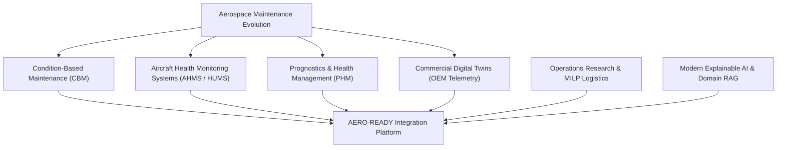

1. **Aircraft Health Monitoring Systems (AHMS / HUMS):** Systems such as Health and Usage Monitoring Systems (HUMS) in military rotorcraft and Boeing AHM / Airbus Airman in commercial aviation record exceedances, vibrations, and fault codes for post-flight analysis.
2. **Prognostics and Health Management (PHM):** Well-established methodologies predicting Remaining Useful Life (RUL) using physics-based models (e.g., Forman crack-growth laws) and data-driven methods (e.g., NASA Turbofan Engine Degradation Simulation datasets).
3. **OEM Digital Twins:** Leading turbine and aerospace manufacturers (GE Vernova, Rolls-Royce TotalCare, Pratt & Whitney) deploy high-fidelity digital replicas of engines to track thermodynamic efficiency and recommend shop visits.
4. **Enterprise Maintenance Information Systems (MIS):** Military and defence enterprise systems (e.g., legacy mainframe logistics, SAP for Aerospace & Defence) track parts inventories and depot work orders.

### 3.2 Landscape Comparison: Existing Capability vs. AERO-READY

```
+---------------------------------------------------------------------------------------------------+
| EXISTING COMMERCIAL / DEFENCE SOLUTIONS                                                          |
| - Siloed by OEM (Engine twin separate from airframe radar or hydraulic system)                    |
| - Tail-number centric (Focuses on optimizing one machine in isolation)                            |
| - Reactive to supply chains (Alerts maintenance, but inventory systems operate independently)     |
| - Black-box statistical or deep-learning outputs lacking actionable maintenance instructions       |
+---------------------------------------------------------------------------------------------------+
                                                  |
                                                  v
+---------------------------------------------------------------------------------------------------+
| AERO-READY'S SYSTEMIC EXTENSION                                                                   |
| - Multi-source data fusion (Telemetry + Tech Logs + Spare Stock + Technician Schedules)          |
| - Fleet-level optimization (Decisions balance whole-squadron sortie availability)                |
| - Graph-propagated impact (Component degradation -> Subsystem -> Aircraft -> Fleet Readiness)     |
| - Mission-aware scheduling (Balancing operational necessity against mechanical risk)              |
| - Human-in-the-loop explainability (SHAP feature attribution + Grounded Copilot technical orders) |
+---------------------------------------------------------------------------------------------------+
```

---

## 4. Research Gap Analysis

To demonstrate academic and technical rigor, the following matrix contrasts established literature and commercial tools against AERO-READY's architectural contributions:

| Domain / Approach | Existing State-of-the-Art | Fundamental Limitation | AERO-READY Contribution |
| :--- | :--- | :--- | :--- |
| **Sensor-based Anomaly Detection** | Isolation Forests, Statistical Process Control (SPC), and Autoencoders applied to high-rate telemetry. | High false-positive rate under dynamic flight regimes (e.g., supersonic dash, hard banking). | Context-aware anomaly scoring normalized against flight envelope regimes (altitude, Mach, G-load). |
| **RUL Prediction** | Deep LSTM, Temporal Convolutional Networks (TCN), and Transformer models trained on run-to-failure data (e.g., C-MAPSS). | Models assume identical operating profiles and ignore maintenance repair interventions between cycles. | Dynamic RUL recalibration factoring ongoing maintenance logs, operating stress history, and physical wear bounds. |
| **Digital Twin** | High-fidelity thermodynamic and FEA computational models developed by primary OEMs. | Computationally heavy, proprietary, siloed to individual subsystems, and inaccessible to operational bases. | Lightweight, event-driven state-machine twin tracking subsystem health indices across the entire airframe hierarchy. |
| **Predictive Maintenance** | Predictive flags generated when sensor readings cross statistical thresholds. | Predicts *that* a failure will occur, but does not provide actionable resource-aware execution plans. | Prescriptive recommendation engine outputting required spares, estimated repair labor hours, and depot location. |
| **Maintenance Scheduling** | Heuristic, rule-based calendars or static flight-hour threshold triggers. | Ignores upcoming mission criticality and local technician bay capacity bottlenecks. | MILP (Mixed-Integer Linear Programming) schedule optimization constrained by mission demands and hangar capacity. |
| **Spare Management** | $(s, S)$ inventory policies based on static MTBF (Mean Time Between Failures) historical averages. | Fails to anticipate sudden burst demands caused by aging fleet fatigue or harsh operating deployments. | Condition-driven spare demand forecasting directly linking component RUL decay to stockout probability. |
| **Fleet Availability** | Retrospective calculation of Mission Capable (MC) / Fully Mission Capable (FMC) percentages. | Reactive lagging metric with zero forward predictive capability. | 30-day forward availability forecasting using Monte Carlo simulations of degradation and scheduled repairs. |
| **Maintenance Copilots** | General-purpose commercial LLMs or static keyword-search PDF readers. | Prone to hallucinations; lacks real-time awareness of aircraft sensor states and structured inventory. | Grounded RAG architecture combining static Technical Orders (TOs) with live aircraft telemetry and inventory state. |
| **What-If Simulation** | Discrete event simulation software (e.g., Arena, AnyLogic) requiring manual offline parameter tuning. | Disconnected from live telemetry; cannot simulate instant operational contingencies during flight ops. | Interactive contingency engine evaluating real-time operational disruptions (e.g., 24h base closure, spare stockout). |

### 4.1 Concise Definition of AERO-READY's Problem Gap
> **AERO-READY addresses the critical operational gap between isolated component failure prognosis and enterprise-level fleet readiness decision-making.** It synthesizes mechanical wear estimation, spare-parts logistics, technician availability, and tactical mission schedules into an explainable, prescriptively optimized maintenance action plan.

---

## 5. Proposed Solution & Pipeline

AERO-READY operates along an end-to-end data and intelligence pipeline. Each stage ingests outputs from its predecessor, transforms and enriches the data, and propagates decisions downstream:

```mermaid
flowchart TD
    subgraph S1["Stage 1: Ingestion & Telemetry"]
        D1["Flight Telemetry (FDR/AHMS)"]
        D2["Maintenance Technical Logs"]
        D3["Inventory & Depot ERP Data"]
        D4["Operational Mission Rosters"]
    end

    subgraph S2["Stage 2: Validation & Quality Gate"]
        V1["Schema Enforcement & Checksums"]
        V2["Missing Value Imputation (Kalman)"]
        V3["Sensor Outlier / Drift Filtering"]
    end

    subgraph S3["Stage 3: AI Health & Prognostics Engine"]
        H1["Regime-Normalized Anomaly Detection"]
        H2["Multi-Component Health Index (0-100)"]
        H3["Remaining Useful Life (RUL) Estimator"]
    end

    subgraph S4["Stage 4: Digital Twin State Sync"]
        T1["Hierarchical Component Twin"]
        T2["Stress & Wear Accumulation Tracking"]
    end

    subgraph S5["Stage 5: Prescriptive Intelligence"]
        P1["Maintenance Action Recommendation"]
        P2["Maintenance Impact Graph Propagation"]
    end

    subgraph S6["Stage 6: Logistics & Fleet Optimization"]
        O1["Spare Demand & Stockout Predictor"]
        O2["MILP Multi-Constraint Fleet Optimizer"]
    end

    subgraph S7["Stage 7: Simulation & Decision Support"]
        W1["What-If Contingency Simulator"]
        W2["30-Day Fleet Availability Forecaster"]
        W3["RAG AI Maintenance Copilot"]
        W4["Mission-Aware Command Dashboard"]
    end

    S1 --> S2 --> S3 --> S4 --> S5 --> S6 --> S7
```

### Detailed Pipeline Stages

1. **Aircraft Data Ingestion:** Collects multi-modal inputs including time-series engine parameters (EGT, N1, N2, vibration amplitude, oil pressure), hydraulic pressures, structural strain gauge readings, historical pilot write-ups, parts catalog inventories, and mission tasking tables.
2. **Data Integration & Fusion:** Maps heterogeneous formats into a unified canonical data model using standardized timestamps, aircraft tail numbers, and universal component serial numbers.
3. **Data Quality & Validation:** Validates physical bounds (e.g., $EGT > 0^\circ C$), rejects corrupted frames, imputes transient sensor dropouts via forward-fill and Kalman smoothing, and isolates sensor calibration drift from physical component degradation.
4. **AI Health Engine:** Executes machine learning pipelines to compute subsystem anomaly scores, multi-sensor Health Indices ($HI \in [0, 100]$), and failure distributions with 90% confidence bounds.
5. **Digital Twin State Tracking:** Updates in-memory software twins representing the airframe, propulsion, hydraulics, and avionics, tracking cycle counts, thermal fatigue, and wear states.
6. **Prescriptive Maintenance Engine:** Identifies candidate maintenance interventions (e.g., "Inspect & Clean", "Line Replacement", "Depot Overhaul") based on wear severity, calculating labor requirements and lead times.
7. **Spare Optimization:** Verifies on-hand stock across local base armories and central supply depots, flags stockout risks, and plans expedited logistics transfers if a critical part is missing.
8. **Fleet Optimization:** Runs mixed-integer optimization across the entire squadron, matching maintenance windows to operational gaps to prevent simultaneous groundings of mission-critical assets.
9. **What-If Simulation:** Allows planners to inject disruption events (e.g., "Base Alpha fuel supply disrupted for 48 hours" or "Sortie surge of 30 additional flight hours this weekend") to view system resilience.
10. **Fleet Availability Forecast:** Generates daily projections of Fully Mission Capable (FMC), Partially Mission Capable (PMC), and Non-Mission Capable (NMC) aircraft.
11. **Mission-Aware Dashboard & Copilot:** Presents interactive visual analytics to technicians and commanders, supplemented by an explainable AI layer and conversational domain assistant.

---

## 6. System Architecture

AERO-READY is organized into a modular nine-tier layered architecture, adhering to separation of concerns, scalability, and robust security principles:

```mermaid
graph TB
    subgraph L1["Layer 1: Data Sources"]
        L1A["Onboard Telemetry (Simulated AHMS/FDR)"]
        L1B["Subsystem Sensors (Propulsion, Hydraulics, Avionics)"]
        L1C["Maintenance Logs & Pilot Debrief Forms"]
        L1D["Base Depot Spare Parts Inventory"]
        L1E["Tactical Flight Rosters & Sortie Requirements"]
    end

    subgraph L2["Layer 2: Data Ingestion"]
        L2A["REST Ingestion Gateway (FastAPI)"]
        L2B["Bulk Historical File Processor (Parquet/CSV)"]
        L2C["Simulated Telemetry Streamer (WebSocket/Redis Streams)"]
    end

    subgraph L3["Layer 3: Data Processing & Quality"]
        L3A["Validation & Checksum Verification"]
        L3B["Regime Segmentation (Climb, Cruise, Descent)"]
        L3C["Time-Series Feature Extraction & Smoothing"]
    end

    subgraph L4["Layer 4: AI/ML Analytics"]
        L4A["Isolation Forest / Autoencoder Anomaly Detectors"]
        L4B["LightGBM Failure Probability Classifiers"]
        L4C["LSTM & Physics-Informed RUL Estimators"]
        L4D["Composite Subsystem Health Index Engine"]
    end

    subgraph L5["Layer 5: Digital Twin Model"]
        L5A["Hierarchical Entity Tree (Aircraft -> Subsystem -> LRU)"]
        L5B["Wear & Cycle Accumulation Ledger"]
        L5C["Synthetic Twin State Simulator"]
    end

    subgraph L6["Layer 6: Prescriptive Intelligence"]
        L6A["Rule & ML-Guided Work-Order Generator"]
        L6B["Maintenance Impact Graph Engine (NetworkX)"]
        L6C["Technical Order Citation Resolver"]
    end

    subgraph L7["Layer 7: Fleet Optimization"]
        L7A["MILP Maintenance Scheduler (PuLP / OR-Tools)"]
        L7B["Spare-Part Stockout & Reorder Optimizer"]
        L7C["Technician & Hangar Resource Balancer"]
    end

    subgraph L8["Layer 8: Simulation Engine"]
        L8A["Monte Carlo Availability Forecaster"]
        L8B["Disruption Scenario Injector (What-If Engine)"]
        L8C["Dynamic Contingency Re-planner"]
    end

    subgraph L9["Layer 9: Presentation & Copilot"]
        L9A["Mission-Aware Commander Dashboard (React/Tailwind)"]
        L9B["Technician Diagnostic Workstation"]
        L9C["Explainable AI (XAI) Insight Panels"]
        L9D["RAG AI Maintenance Copilot (LangChain + Vector DB)"]
    end

    L1 --> L2 --> L3 --> L4 --> L5 --> L6 --> L7 --> L8 --> L9
```

### Detailed Layer Breakdown

#### Layer 1 — Data Sources
* **Aircraft Telemetry:** 1 Hz to 20 Hz sampled parameters (Exhaust Gas Temp, Fan Speed N1, Core Speed N2, Vibration RMS, Hydraulic Pressure, Fuel Flow Rate).
* **Technical Records:** Historical unstructured maintenance log entries, pilot discrepancy write-ups (Discrepancy / Action Taken), and component replacement stamps.
* **Logistics & Depot Inventory:** Available stock levels, bin locations, lead times for procurement, and reconditioned component buffers.
* **Operational Requirements:** Planned air sorties, target mission-capable rates, escort readiness quotas, and runway maintenance closures.

#### Layer 2 — Data Ingestion
* **High-Throughput Ingestion Gateway:** Asynchronous FastAPI endpoints accepting encrypted payload batches.
* **Streaming Telemetry Channel:** Redis Streams enabling real-time simulated telemetry replay during operational flight phases.
* **Batch Historical Loader:** Automated ingestion of historical flight log files with schema validation.

#### Layer 3 — Data Processing & Validation
* **Data Cleaning & Normalization:** Rolling standard deviation, median filters for outlier rejection, and forward-fill for packet loss.
* **Flight Regime Segmentation:** Algorithms classify data into taxi, takeoff, climb, high-altitude cruise, combat maneuvers, and descent/landing to ensure valid comparisons.
* **Feature Engineering:** Calculation of thermodynamic efficiency metrics, temperature deltas ($\Delta EGT$), vibration power spectral density (PSD), and cycle counters.

#### Layer 4 — AI/ML Analytics
* **Anomaly Detection Engine:** Ensemble of Isolation Forest and Deep Autoencoders to flag deviation from nominal baselines.
* **Failure Classification:** Gradient-boosted decision trees (LightGBM) estimating the probability of failure across specific fault categories within 50 flight hours.
* **RUL Prognostics:** Recurrent Neural Networks (LSTM) trained on cumulative degradation paths to predict remaining operating hours before threshold breach.
* **Health Index Formulation:** Weighted aggregation of sensor deviations into normalized subsystem scores ($0.0 \text{ to } 100.0$).

#### Layer 5 — Digital Twin
* **State Machine:** In-memory digital representation mirroring physical aircraft configurations:
  $$\text{Airframe} \longrightarrow \text{Subsystems (Propulsion, Hydraulics, Avionics, Structures)} \longrightarrow \text{Components (LRUs)}$$
* **Virtual State Tracking:** Accumulates simulated equivalent operating cycles (EOC) and thermal stress hours based on flight intensity.

#### Layer 6 — Prescriptive Intelligence
* **Action Generation:** Translates prognosis into actionable work packages (e.g., "Replace Fuel Metering Valve Part #FMV-204").
* **Impact Propagation:** Evaluates how deferred maintenance on a minor component degrades parent subsystem reliability using the Maintenance Impact Graph.
* **Downtime Estimation:** Computes expected hangar dwell time based on historical repair times and required technician skill levels.

#### Layer 7 — Fleet Optimization
* **Mathematical Scheduling:** Employs Mixed-Integer Linear Programming (MILP) to minimize maintenance delays and maximize fleet availability while respecting:
  * Maximum simultaneous hangar capacity per base.
  * Certified technician shift availability.
  * Priority sortie generation windows.
* **Inventory Allocation:** Assigns available spares to highest-urgency maintenance actions, generating expedited transfer orders between depots if necessary.

#### Layer 8 — What-If Simulation
* **Contingency Testing:** Simulates shocks to the fleet ecosystem (e.g., "Depot Bravo struck by weather closure for 36 hours; Aircraft A03 grounded with fuel leak").
* **Availability Forecasting:** Projects daily FMC/PMC/NMC curves over a forward 30-day window under nominal and stressed operational conditions.

#### Layer 9 — Presentation & Copilot
* **Interactive Command UI:** Modern responsive dashboard featuring real-time health heatmaps, tail-number drill-downs, Gantt-style maintenance schedules, and simulation scenario builders.
* **Grounded AI Copilot:** Natural language interface parsing technical orders, displaying sensor graphs, and explaining the reasoning behind optimization decisions.

---

## 7. AI/ML Methodology

To avoid black-box ambiguity, AERO-READY implements specific, justified algorithms tailored to each analytical task.

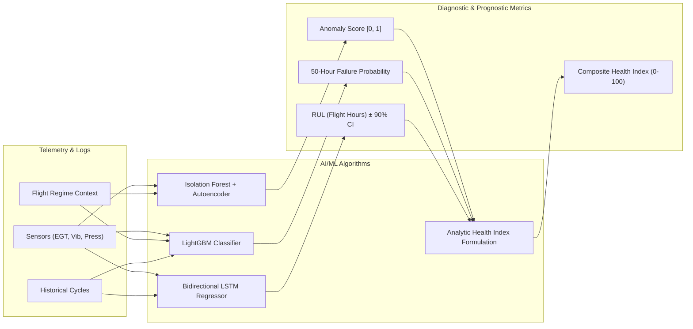

### 7.1 Anomaly Detection Module
* **Problem:** Detect incipient mechanical and electrical anomalies in aircraft subsystems before threshold alarms or built-in test (BIT) failures trigger.
* **Input Features:** Cleaned, regime-normalized continuous sensor variables:
  $$X_t = [T_{\text{EGT}}, N_1, N_2, \text{Vib}_{\text{fan}}, \text{Vib}_{\text{core}}, P_{\text{oil}}, T_{\text{oil}}, P_{\text{hyd}}$$
* **Algorithm Candidates:**
  1. *Isolation Forest:* Tree-based partitioning effective for high-dimensional sensor data with low contamination rates.
  2. *Deep Undercomplete Autoencoder:* Neural network trained on nominal flight data; reconstruction error serves as the anomaly score:
     $$\mathcal{L}_{\text{recon}} = ||X_t - \hat{X}_t||^2$$
* **Selected Architecture:** Hybrid ensemble. Isolation Forest provides fast real-time scoring, while Autoencoder reconstruction error isolates the exact sensor driving the anomaly.
* **Output:** Anomaly Score $\in [0.0, 1.0]$ with an alert flag if score $> 0.72$ for three consecutive flight cycles.
* **Evaluation Metrics:** Precision, Recall, F1-Score, False Alarm Rate (FAR per 1,000 flight hours).

### 7.2 Failure Prediction Module
* **Problem:** Classify the probability that an aircraft component will suffer a functional failure within an upcoming operational window ($H = 50$ flight hours).
* **Input Features:** Rolling 10-flight mean, standard deviation, kurtosis, and rate of change of telemetry parameters, combined with historical cycle counts and calendar time since last overhaul.
* **Algorithm Candidates:**
  1. *Random Forest Classifier*
  2. *LightGBM (Light Gradient Boosting Machine)*
  3. *XGBoost*
* **Selected Architecture:** LightGBM, selected for its rapid inference latency, native handling of missing telemetry values, and high performance on tabular tabular-temporal feature sets.
* **Output:** Calibrated probability of failure $P(\text{Failure}_{50\text{h}}) \in [0.0, 1.0]$ mapped to risk classifications:
  * Low ($P < 0.20$)
  * Moderate ($0.20 \le P < 0.50$)
  * Elevated ($0.50 \le P < 0.75$)
  * Critical ($P \ge 0.75$)
* **Evaluation Metrics:** Area Under ROC Curve (ROC-AUC), PR-AUC, Brier Score (probability calibration).

### 7.3 Remaining Useful Life (RUL) Prediction Module
* **Problem:** Estimate the continuous remaining operational flight hours (EFH) before a degrading component breaches safe structural or thermodynamic operating limits.
* **Input Features:** Sequence of sensor measurements over the previous $k$ flight cycles ($k=30$), normalized by operational altitude and Mach number.
* **Algorithm Candidates:**
  1. *Gradient Boosted Regressor (with lag features)*
  2. *Bidirectional Long Short-Term Memory (Bi-LSTM)*
  3. *Temporal Convolutional Networks (TCN)*
* **Selected Architecture:** Two-layer Bidirectional LSTM network with a dense regression head and dropout ($p=0.2$). Recurrent architectures effectively capture temporal degradation dynamics without requiring manual window feature extraction.
* **Output:** Expected RUL in Equivalent Flight Hours (EFH) alongside a 90% confidence interval $[\text{RUL}_{\text{lower}}, \text{RUL}_{\text{upper}}]$ derived via Monte Carlo Dropout:
  $$\hat{y}_{\text{RUL}} = \mathbb{E}[\text{LSTM}(X_{1:k})]$$
* **Evaluation Metrics:** Mean Absolute Error (MAE), Root Mean Squared Error (RMSE), and the standard NASA PHM Asymmetric Scoring Metric (which penalizes late predictions more severely than early predictions):
  $$S = \sum_{i=1}^N \begin{cases} e^{-d_i / 13} - 1 & \text{if } d_i < 0 \text{ (late)} \\ e^{d_i / 10} - 1 & \text{if } d_i \ge 0 \text{ (early)} \end{cases} \quad \text{where } d_i = \hat{y}_i - y_i$$

### 7.4 Subsystem & Aircraft Composite Health Index (HI)
To provide operational commanders with an intuitive single-metric summary of aircraft mechanical state, AERO-READY derives a normalized Composite Health Index ($HI \in [0, 100]$):

$$HI_{\text{aircraft}} = \sum_{s \in \mathcal{S}} w_s \cdot HI_s$$

Where $\mathcal{S} = \{\text{Propulsion}, \text{Hydraulics}, \text{Avionics}, \text{Airframe}\}$, $w_s$ represents the subsystem criticality weight ($\sum w_s = 1.0$), and the subsystem health index $HI_s$ is computed as:

$$HI_s = 100 \cdot \left(1 - \max\left(A_s, \, P_{\text{fail}, s}, \, \left[1 - \frac{\text{RUL}_s}{\text{Threshold}_{\text{nominal}}}\right]^+\right)\right)$$

* $A_s$: Anomaly score of subsystem $s$.
* $P_{\text{fail}, s}$: 50-hour failure probability of subsystem $s$.
* $\text{Threshold}_{\text{nominal}}$: Baseline expected service life between planned inspections.

---

## 8. Hybrid AI & Physics-Informed Approach

### 8.1 The Reality of Aerospace Data Scarcity
In commercial e-commerce or web applications, machine learning models benefit from millions of failure examples. In military aviation:
* Aircraft components are maintained conservatively; components are rarely flown to catastrophic failure.
* Complete "run-to-failure" telemetry traces are scarce, restricted, or non-existent for frontline fighter jets.
* Purely data-driven black-box models trained on small datasets are prone to overfitting and can produce unphysical predictions under novel flight maneuvers.

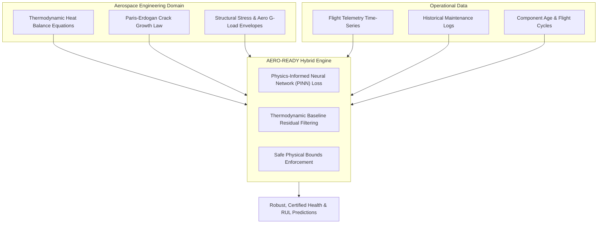

### 8.2 Architectural Implementation of the Hybrid Engine
AERO-READY incorporates physical engineering principles directly into its machine learning architecture:

1. **Thermodynamic Residual Modeling:**
   Rather than training a neural network to predict raw Exhaust Gas Temperature ($EGT$), AERO-READY utilizes a standard thermodynamic cycle model (Brayton cycle) to compute the theoretical expected temperature $EGT_{\text{theory}}$ for the current throttle, altitude, and Mach number. The ML model is trained exclusively on the *residual*:
   $$\Delta EGT_{\text{residual}} = EGT_{\text{observed}} - EGT_{\text{theory}}$$
   A persistent positive drift in $\Delta EGT_{\text{residual}}$ indicates compressor fouling or turbine erosion, decoupling environmental flight dynamics from mechanical degradation.

2. **Physics-Constrained Loss Functions:**
   During RUL estimation, physical monotonicity constraints are enforced via penalty terms in the neural network loss function: mechanical wear cannot spontaneously decrease without a logged maintenance event.
   $$\mathcal{L}_{\text{total}} = \mathcal{L}_{\text{MSE}} + \lambda_{\text{physics}} \sum_{t} \max\left(0, \, \hat{y}_{\text{RUL}}(t) - \hat{y}_{\text{RUL}}(t-1)\right)$$

3. **Cumulative Fatigue Damage Accumulation:**
   Stress cycles are calculated using the established Rainflow-Counting Algorithm applied to structural strain gauge data, propagating damage according to the Miner-Palmgren linear damage accumulation hypothesis:
   $$D = \sum_{i=1}^k \frac{n_i}{N_i}$$
   where $n_i$ is the number of cycles at stress level $S_i$, and $N_i$ is the cycles to failure from empirical S-N curves.

This hybrid approach ensures high predictive stability even when operating outside the statistical distribution of training data.

---

## 9. Mission-Aware Maintenance Engine

### 9.1 Multi-Objective Decision Support Philosophy
Traditional maintenance software relies strictly on risk thresholds: if an asset's failure risk exceeds an arbitrary threshold, it is marked for grounding. In operational air power, maintenance decisions cannot be decoupled from tactical commitments:

> **Example Operational Conflict:**
> * **Aircraft A (Tail #A02):** Failure probability of 42% on its primary hydraulic pump. Assigned mission: Routine local instrument check flight 3 days from now.
> * **Aircraft B (Tail #A07):** Failure probability of 36% on its engine oil scavenge pump. Assigned mission: High-readiness Quick Reaction Alert (QRA) air-defence patrol in 8 hours.
> * **Depot Constraint:** Only one specialized hangar bay and technician team are available today.

A naive failure-risk system would ground Aircraft A first because $42\% > 36\%$.  
**AERO-READY's Mission-Aware Engine prioritizes Aircraft B for immediate preemptive service**, recognizing that an in-flight abort during a high-readiness operational window carries severe operational consequences, whereas Aircraft A's non-urgent flight can be rescheduled or transferred to another available airframe without degrading squadron readiness.

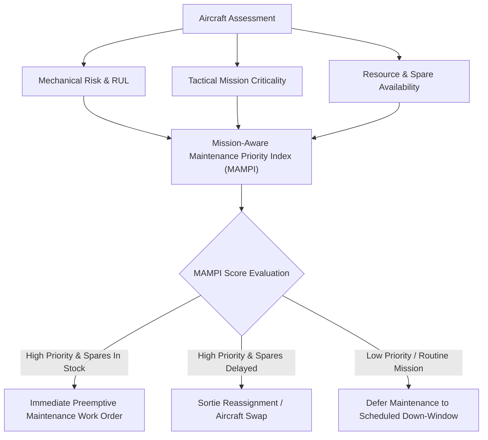

### 9.2 Mathematical Formulation: MAMPI
AERO-READY calculates a Mission-Aware Maintenance Priority Index ($\text{MAMPI}_i$) for each aircraft $i \in \{1, \dots, N\}$:

$$\text{MAMPI}_i = \alpha \cdot P_{\text{fail}, i} + \beta \cdot \text{MCF}_i + \gamma \cdot \left(1 - \frac{\text{RUL}_i}{\text{MissionDuration}_i \times 2}\right) + \delta \cdot \text{SpareAvailabilityScore}_i$$

Where:
* $P_{\text{fail}, i}$: Estimated component failure probability within the mission window $[0, 1]$.
* $\text{MCF}_i$: Mission Criticality Factor $\in [0.1, 1.0]$:
  * Combat Air Patrol / QRA: $1.0$
  * Tactical Air Transport / Escort: $0.7$
  * Routine Navigational / Instrument Training: $0.3$
  * Ferry / Static Readiness: $0.1$
* $\text{SpareAvailabilityScore}_i$: Boolean or fractional score indicating whether required parts and tools are on-hand locally.
* $\alpha, \beta, \gamma, \delta$: Weighting coefficients tuned by squadron command doctrine ($\sum = 1.0$).

This formulation ensures that maintenance scheduling is directly aligned with tactical operational imperatives.

---

## 10. Maintenance Impact Graph

### 10.1 Graph Dependency Modeling
Aircraft are deeply integrated systems of systems. A localized fault in a secondary component does not exist in isolation; it propagates upward into subsystem derating, demands specific ground resources, and ultimately influences base-wide fleet availability.

AERO-READY models these interdependencies using a Directed Acyclic Graph (DAG) implemented via `NetworkX`:

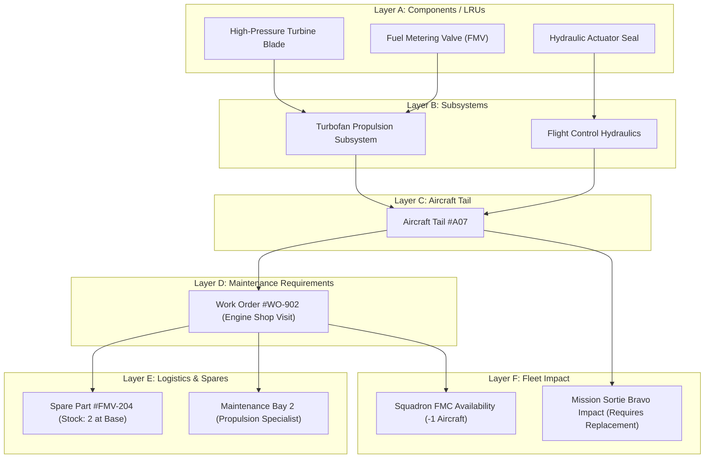

### 10.2 Mathematical Impact Propagation
Let the system graph be $\mathcal{G} = (\mathcal{V}, \mathcal{E})$, where vertices $\mathcal{V}$ encompass components, subsystems, aircraft, work orders, spares, and missions.

1. **Subsystem Degradation Propagation:**
   For a subsystem vertex $v_s$, its health score $H(v_s)$ is a lower-bound aggregation of its constituent component vertices $\mathcal{C}(v_s)$:
   $$H(v_s) = \min_{c \in \mathcal{C}(v_s)} \left( H(c) \right) \cdot \prod_{c \in \mathcal{C}(v_s)} \left(1 - \text{Penalty}(c)\right)$$
2. **Readiness Impact Function:**
   If $H(v_s) < \tau_{\text{critical}}$, the parent aircraft status $v_a$ transitions from **Fully Mission Capable (FMC)** to **Partially Mission Capable (PMC)** or **Non-Mission Capable (NMC)**.
3. **Logistics Bottleneck Propagation:**
   If a dependent spare part vertex $v_p$ has inventory count $\text{Stock}(v_p) = 0$, the edge weight representing maintenance duration $T_{\text{repair}}(v_m)$ is updated dynamically:
   $$T_{\text{repair, effective}} = T_{\text{labor}} + \text{LeadTime}_{\text{procure}}(v_p)$$
   This immediately propagates into the fleet availability timeline, recalculating squadron availability curves.

---

## 11. Spare-Part Demand & Inventory Optimization

### 11.1 Condition-Driven Spare Demand
Traditional military inventory systems rely on static historical Mean Time Between Failures (MTBF) and periodic reorder cycles. This produces the classic supply chain "bullwhip effect": bases suffer sudden stockouts of high-wear items during high-tempo operations while accumulating redundant capital in slow-moving spares.

AERO-READY links spare-part demand directly to **live physical degradation trajectories**:


### 11.2 Mathematical Formulation: Dynamic Demand & Reorder
1. **Time-Varying Failure Probability:**
   For any component $k$ with estimated RUL distribution $f_k(t)$, the probability of component failure requiring a replacement spare during the upcoming planning interval $[T, T + \Delta t]$ is:
   $$P_k(\text{Demand in } \Delta t) = \int_T^{T + \Delta t} f_k(t) \, dt$$
2. **Aggregated Base Demand Distribution:**
   For a fleet of $M$ aircraft stationed at a base, the aggregate demand $D_{\text{total}}(\Delta t)$ for part type $j$ follows a Poisson-binomial distribution with mean parameter:
   $$\lambda_j(\Delta t) = \sum_{m=1}^M P_{m, j}(\text{Demand in } \Delta t)$$
3. **Safety Stock & Reorder Point Calculation:**
   The dynamic reorder point $\text{ROP}_j$ factoring supplier lead time $L_j$ (days) and target service level $Z_\alpha$ (e.g., $98\%$ combat readiness):
   $$\text{ROP}_j = \lambda_j(L_j) + Z_\alpha \cdot \sqrt{\lambda_j(L_j) \cdot \sigma_{L_j}^2 + L_j \cdot \sigma_{D_j}^2}$$

### 11.3 Simulated Inventory Example

| Part ID | Part Description | Subsystem | On-Hand Base Stock | Central Depot Stock | Lead Time (Depot $\to$ Base) | 14-Day Predicted Demand | Stockout Risk Without Action | Recommended Prescriptive Action |
| :--- | :--- | :--- | :--- | :--- | :--- | :--- | :--- | :--- |
| **SP-TRB-101** | High-Pressure Turbine Nozzle | Propulsion | 1 | 4 | 48 hours | 2.1 units | **$68\%$ (High)** | Dispatch 2 units from Central Depot immediately. |
| **SP-HYD-204** | Main Servo Actuator Valve | Hydraulics | 3 | 8 | 24 hours | 0.8 units | **$4\%$ (Low)** | Maintain normal buffer; no transfer required. |
| **SP-AVN-309** | Radar Power Supply Module | Avionics | 0 | 2 | 72 hours | 1.2 units | **$91\%$ (Critical)** | Expedite emergency logistics transfer; ground risk. |
| **SP-ENG-402** | Fuel Flow Metering Unit | Propulsion | 2 | 5 | 36 hours | 1.4 units | **$18\%$ (Acceptable)** | Reorder standard replenishment batch. |

---

## 12. What-If Fleet Simulation Engine

A key differentiator of AERO-READY is its interactive discrete-event simulation engine, which allows operations planners to stress-test fleet resilience against operational contingencies.

```mermaid
sequenceDiagram
    autonumber
    actor Planner as Ops Planner / Commander
    participant Sim as What-If Simulation Engine
    participant Twin as Fleet Digital Twin
    participant Opt as MILP Optimizer
    participant UI as Availability Dashboard

    Planner->>Sim: Inject Disruption (e.g. Spare Delay + Base Capacity -50%)
    Sim->>Twin: Clone Current Fleet State
    Sim->>Sim: Perturb Constraints & RUL Curves
    Sim->>Opt: Request Re-Optimization under New Constraints
    Opt-->>Sim: Return Alternative Maintenance Schedule
    Sim->>Sim: Compute Delta in Fleet Availability (FMC/PMC/NMC)
    Sim-->>UI: Render Availability Impact & Remediation Plan
    Planner->>UI: Commit Contingency Schedule to Operations
```

### 12.1 Detailed Simulation Scenarios

#### Scenario 1: Aircraft Unscheduled Grounding for 24 Hours
* **Trigger Input:** Aircraft A04 suffers a bird strike or unpredicted hydraulic leak; unavailable for 24 hours.
* **Simulation Process:** System removes A04 from the available pool, scans all scheduled sorties for A04 over the next 48 hours, and searches the fleet for an alternative airframe meeting payload and fuel profile requirements with $HI > 85$.
* **Fleet Impact:** Squadron FMC drops by $8.3\%$ for 24 hours.
* **Alternative Plan:** Reassign Sortie 102 to Aircraft A08 (which has 42 safe flight hours remaining before scheduled phase inspection). Shift A04's scheduled maintenance forward into the downtime window.
* **Predicted Availability:** 10 out of 12 aircraft ($83.3\%$) remain mission ready.

#### Scenario 2: Critical Spare Part Unavailable
* **Trigger Input:** High-Pressure Turbine Seal (SP-TRB-101) delayed by 5 days due to external supply line interruption.
* **Simulation Process:** System identifies Aircraft A07's engine work order requiring this seal. Extrapolates current wear rate under three operating regimes (peacetime training, high-altitude cruise, full combat power).
* **Fleet Impact:** A07 cannot complete planned heavy engine overhaul on Day 3. Grounding A07 reduces 14-day sortie capacity.
* **Alternative Plan:** Apply a software engine derating recommendation: restrict A07 to low-stress training flights ($\le 85\%$ max throttle). This extends the component's remaining safe flight window by 72 hours, bridging the gap until the delayed spare arrives without grounding the aircraft.
* **Predicted Availability:** FMC rate maintained at $91.6\%$ with minor operational profile constraint on one tail.

#### Scenario 3: Maintenance Bay Capacity Reduced by 50%
* **Trigger Input:** Hangar Bay 1 closed for electrical maintenance; base repair throughput reduced from 4 aircraft to 2 aircraft simultaneously for 72 hours.
* **Simulation Process:** MILP optimizer prioritizes work orders based on the Mission-Aware Maintenance Priority Index (MAMPI).
* **Fleet Impact:** Maintenance queue backlog increases; risk of cascading groundings.
* **Alternative Plan:** Postpone two low-urgency non-destructive inspections (NDI) on healthy aircraft ($HI > 92$). Consolidate available technician hours onto high-readiness airframes A01 and A05.
* **Predicted Availability:** Zero operational mission cancellations; average maintenance turnaround delay kept under 6 hours.

#### Scenario 4: Concurrent Multi-Aircraft Fault Injection
* **Trigger Input:** Three aircraft (A02, A07, A11) concurrently indicate elevated vibration scores following a joint high-G tactical exercise.
* **Simulation Process:** Evaluates multi-tail repair dependencies against available vibration diagnostic equipment and certified propulsion technicians.
* **Fleet Impact:** Immediate ground-alert breach if all three aircraft are grounded simultaneously.
* **Alternative Plan:** Stagger maintenance interventions: A07 (highest degradation rate) is serviced in Bay 2 immediately; A02 is cleared for a single low-altitude ferry flight; A11 is placed on warm standby.
* **Predicted Availability:** Minimum squadron alert readiness quota ($75\%$) strictly preserved.

#### Scenario 5: Sortie Generation Surge (Combat Readiness Surge)
* **Trigger Input:** Operational command orders a 40% increase in daily flight hours over a sustained 7-day period.
* **Simulation Process:** Simulates accelerated wear progression across all 12 airframes; tracks dynamic RUL consumption rates.
* **Fleet Impact:** Rapid wear acceleration causes five aircraft to simultaneously reach inspection thresholds on Day 6.
* **Alternative Plan:** Preemptively rotate flight allocations across airframes to balance wear evenly across the fleet, preventing clustered maintenance down-windows.
* **Predicted Availability:** Fleet readiness remains above $80\%$ throughout the 7-day surge without post-exercise depot paralysis.

---

## 13. Digital Twin State Architecture

AERO-READY maintains an event-driven, hierarchical software Digital Twin representing every physical airframe in the fleet.

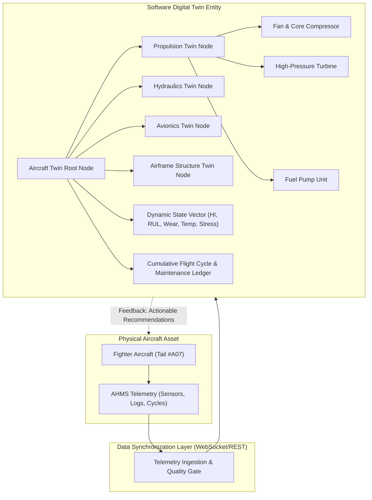

### 13.1 Twin State Variables
Each node in the Digital Twin hierarchy maintains a real-time state vector $\mathbf{S}_t$:

$$\mathbf{S}_t = \begin{bmatrix} 
\text{HealthIndex} \in [0.0, 100.0] \\
\text{CurrentAnomalyScore} \in [0.0, 1.0] \\
\text{PredictedRUL} \in [0, \infty) \text{ EFH} \\
\text{CumulativeFlightCycles} \in \mathbb{N} \\
\text{ThermalStressIndex} \in [0.0, \infty) \\
\text{MaintenanceState} \in \{\text{Nominal}, \text{Flagged}, \text{WorkOrderIssued}, \text{InDepot}\} \\
\text{OperationalReadiness} \in \{\text{FMC}, \text{PMC}, \text{NMC}\}
\end{bmatrix}$$

### 13.2 Twin State Synchronization
1. **Post-Flight Batch Update:** Following flight termination, full FDR telemetry archives are ingested, updating cumulative wear indices, stress-cycle counts, and RUL trajectories.
2. **Real-Time Streaming Update:** During flight or simulated test runs, high-rate sensor streams (1 Hz) trigger state-space updates in the digital twin.
3. **Maintenance Reconciliation:** When a technician closes a verified work order, the associated component twin resets its wear state, and the parent subsystem health index is recomputed.

> **Engineering Disclaimer:** The AERO-READY Digital Twin is a computational software state machine and analytics model designed for maintenance decision support. It is not an aerodynamic flight-simulator twin or an FAA/CEMILAC-certified airworthiness-control system.

---

## 14. RAG-Based AI Maintenance Copilot

### 14.1 Motivation & Design Objectives
Maintenance technicians and squadron planners deal with thousands of pages of technical documentation (Technical Orders, Illustrated Parts Catalogs, Flight Manuals, Service Bulletins) alongside rapidly changing flight schedules. General-purpose commercial LLMs cannot be deployed in this context because:
* They hallucinate facts and part numbers.
* They lack awareness of the live sensor state of the aircraft.
* They leak data if hosted on external public clouds.

AERO-READY's **AI Maintenance Copilot** is an on-premise, retrieval-augmented conversational agent that grounds its answers in verified technical orders and live telemetry state.

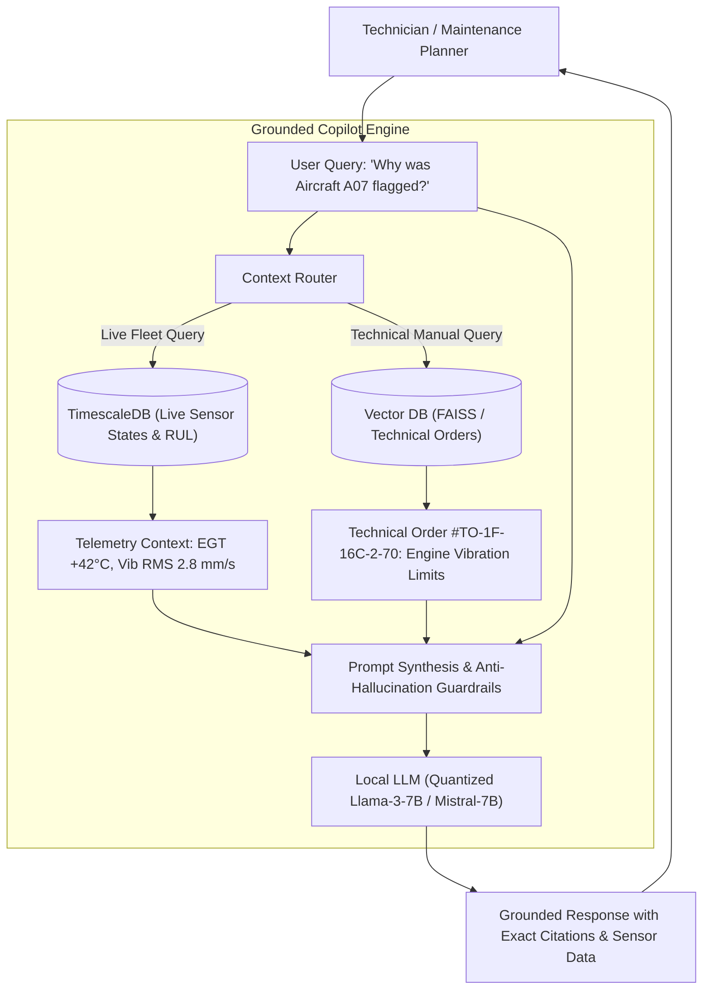

### 14.2 Technical Architecture & Guardrails
1. **Document Ingestion & Chunking:** Technical orders and repair logs are chunked into 512-token segments with 64-token overlaps, embedded via `sentence-transformers/all-MiniLM-L6-v2`, and indexed in an in-memory FAISS / pgvector store.
2. **Context Enrichment:** The copilot intercepts queries referencing aircraft tail numbers (e.g., "A07"), automatically querying the relational database for current sensor anomalies, recent maintenance records, and active work orders, injecting this structured payload into the system prompt.
3. **Hallucination Prevention Protocol:**
   * The model prompt strictly enforces: *"If the technical manual excerpt provided does not explicitly contain the torque specification or procedure, respond with 'Data not found in authorized documentation'—never estimate."*
   * Every response must append explicit citations: `[Source: TO-1F-Engine-Inspection, Section 4.2, Page 88]`.
4. **Human-in-the-Loop Constraint:** The copilot is strictly advisory. All suggested actions (e.g., "Generate Work Order") require one-click confirmation and digital signature by a human maintenance officer.

---

## 15. Explainable AI (XAI) Framework

### 15.1 The Imperative for Interpretability
In military and defence aviation, an uninterpretable machine learning prediction will be rejected by maintenance officers. If an AI system recommends grounding a multi-million-dollar fighter aircraft with an alert stating "Risk = 88%" without explaining why, technicians cannot verify the diagnosis or order the correct spare parts.

### 15.2 XAI Implementation
AERO-READY embeds a multi-layered explainability engine directly into its diagnostic and prognostic pipelines:

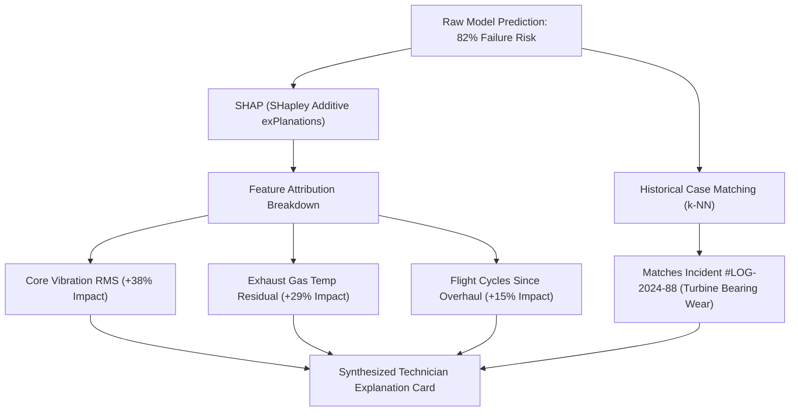

### 15.3 Concrete Explanation Card Output Example

```json
{
  "aircraft_tail_number": "A07",
  "subsystem": "Propulsion (Engine #1)",
  "prediction": {
    "failure_probability_50h": 0.82,
    "confidence_interval": [0.77, 0.86],
    "estimated_rul_hours": 18.4
  },
  "explainability": {
    "primary_drivers": [
      {
        "feature": "Vibration_RMS_Core",
        "observed_value": "4.2 mm/s",
        "baseline_nominal": "1.8 mm/s",
        "shap_importance_weight": 0.38,
        "interpretation": "Vibration amplitude in the high-pressure turbine spool exceeds 95th percentile baseline."
      },
      {
        "feature": "Delta_EGT_Residual",
        "observed_value": "+38.4 °C",
        "baseline_nominal": "±5.0 °C",
        "shap_importance_weight": 0.29,
        "interpretation": "Thermodynamic exhaust gas temperature residual indicates declining turbine efficiency."
      },
      {
        "feature": "Cumulative_Thermal_Cycles",
        "observed_value": "412 cycles",
        "baseline_nominal": "< 400 cycles",
        "shap_importance_weight": 0.15,
        "interpretation": "Engine has exceeded scheduled minor inspection interval threshold."
      }
    ],
    "counterfactual_insight": "If Vibration_RMS_Core were reduced to 2.1 mm/s, the 50-hour failure risk would decline from 82% to 24%.",
    "relevant_historical_records": [
      {
        "record_id": "REC-ENG-2025-104",
        "date": "2025-11-14",
        "findings": "High core vibration caused by spalling on bearing #4 inner race. Replaced bearing and re-balanced spool."
      }
    ]
  }
}
```

---

## 16. Data Strategy & Synthetic Datasets

### 16.1 Ethical & Security Boundary Conditions
To adhere to national security protocols and intellectual property standards, **AERO-READY does not require, utilize, or expose classified military operational data**. The prototype architecture is engineered to run on a hybrid combination of validated open-source benchmarks and mathematically rigorous synthetic data generation.

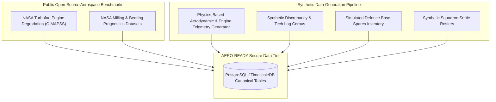

### 16.2 Data Sources & Generation Strategy

1. **NASA C-MAPSS Turbofan Benchmark:**
   Provides standardized run-to-failure degradation trajectories for turbofan engines under varying altitude, Mach number, and throttle combinations. Used directly to train and benchmark the core RUL prognostic models.
2. **Synthetic High-Frequency Telemetry Generator:**
   A custom Python-based physics simulation script generates multi-channel sensor data (1 Hz to 10 Hz) for a simulated squadron of 12 fighter aircraft. The simulation models nominal flight regimes (takeoff, climb, cruise, combat maneuvers, landing) and injects realistic failure modes:
   * Progressive compressor fouling (gradual $\Delta EGT$ increase and fuel flow surge).
   * Turbine bearing spalling (exponentially increasing vibration amplitude).
   * Hydraulic pump cavitation (pressure drops and high-frequency ripples).
3. **Synthetic Maintenance Log Corpus:**
   A corpus of 1,200 synthetic maintenance work orders, pilot write-ups, and technician action notes generated using standardized aerospace terminology (e.g., ATA chapters, standard Air Force discrepancy codes) to train the RAG copilot and text embeddings.
4. **Synthetic Inventory & Mission Schedules:**
   A simulated airbase logistics database with 150 line-replaceable units (LRUs), stock levels, lead times, and a 30-day rolling squadron mission roster.

### 16.3 Path to Operational Deployment
When transitioning from prototype to authorized defence deployment, the platform requires zero architectural changes: the synthetic database adapters are replaced with authorized military enterprise adapters (e.g., 1553B data bus flight recorders, enterprise defence logistics systems), running within sovereign air-gapped sovereign cloud or on-premise base servers.

---

## 17. Database Design & Data Models

The database architecture is implemented on **PostgreSQL with TimescaleDB extensions** to efficiently handle both high-frequency time-series telemetry and structured relational logistics entities.

### 17.1 Entity Relationship Diagram (ERD)

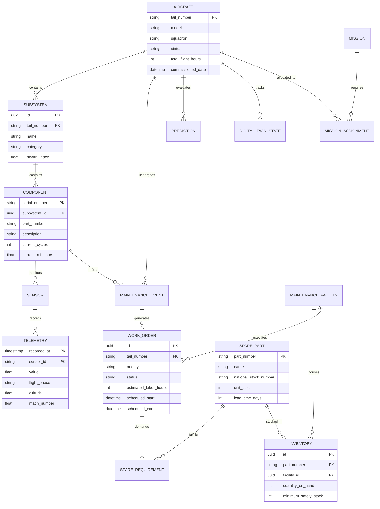

### 17.2 Database Schemas (DDL Core Tables)

```sql
-- Core Aircraft Entity Table
CREATE TABLE aircraft (
    tail_number VARCHAR(16) PRIMARY KEY,
    model VARCHAR(64) NOT NULL,
    squadron VARCHAR(64) NOT NULL,
    readiness_status VARCHAR(16) NOT NULL CHECK (readiness_status IN ('FMC', 'PMC', 'NMC')),
    total_flight_hours NUMERIC(8, 2) NOT NULL DEFAULT 0.0,
    cumulative_cycles INT NOT NULL DEFAULT 0,
    last_phase_inspection_at TIMESTAMP WITH TIME ZONE,
    created_at TIMESTAMP WITH TIME ZONE DEFAULT CURRENT_TIMESTAMP
);

-- TimescaleDB Hypertable for High-Frequency Telemetry
CREATE TABLE sensor_telemetry (
    recorded_at TIMESTAMP WITH TIME ZONE NOT NULL,
    tail_number VARCHAR(16) NOT NULL REFERENCES aircraft(tail_number),
    sensor_id VARCHAR(32) NOT NULL,
    subsystem VARCHAR(32) NOT NULL,
    reading_value DOUBLE PRECISION NOT NULL,
    flight_phase VARCHAR(32) NOT NULL,
    altitude_ft DOUBLE PRECISION,
    mach_speed DOUBLE PRECISION
);
SELECT create_hypertable('sensor_telemetry', 'recorded_at');

-- Component & LRU Inventory Table
CREATE TABLE spare_parts (
    part_number VARCHAR(32) PRIMARY KEY,
    nsn_code VARCHAR(32) UNIQUE,
    name VARCHAR(128) NOT NULL,
    subsystem VARCHAR(32) NOT NULL,
    unit_cost_inr NUMERIC(12, 2) NOT NULL,
    standard_lead_time_days INT NOT NULL,
    criticality_tier VARCHAR(8) CHECK (criticality_tier IN ('A', 'B', 'C'))
);

-- Maintenance Work Order Records
CREATE TABLE work_orders (
    id UUID PRIMARY KEY DEFAULT gen_random_uuid(),
    tail_number VARCHAR(16) NOT NULL REFERENCES aircraft(tail_number),
    part_number VARCHAR(32) REFERENCES spare_parts(part_number),
    prescribed_action VARCHAR(256) NOT NULL,
    status VARCHAR(32) NOT NULL CHECK (status IN ('Draft', 'Approved', 'InProgress', 'Completed', 'Deferred')),
    priority VARCHAR(16) NOT NULL CHECK (priority IN ('Routine', 'Priority', 'Urgent', 'AOG')),
    estimated_duration_hours NUMERIC(6, 2) NOT NULL,
    scheduled_start TIMESTAMP WITH TIME ZONE,
    completed_at TIMESTAMP WITH TIME ZONE,
    assigned_bay VARCHAR(32)
);
```

---

## 18. Backend Architecture & API Specifications

The AERO-READY backend is implemented in **Python 3.11** using **FastAPI** for high-performance asynchronous REST endpoints, integrated with **TimescaleDB** and **Redis**.

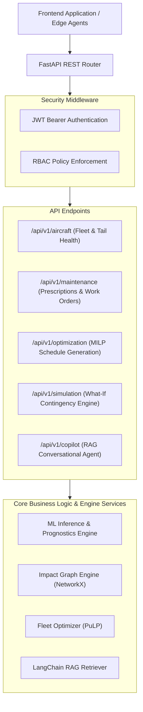

### 18.1 Key REST API Specifications

| Method | Endpoint | Description | Request Body Payload | Response Format |
| :--- | :--- | :--- | :--- | :--- |
| `GET` | `/api/v1/aircraft` | Retrieve fleet health status, readiness ratings, and aggregate metrics. | None | `Array<AircraftSummaryDTO>` |
| `GET` | `/api/v1/aircraft/{id}/health` | Retrieve real-time health index, sensor anomalies, and risk score for a specific tail number. | None | `AircraftHealthDetailDTO` |
| `GET` | `/api/v1/aircraft/{id}/rul` | Retrieve RUL prediction, confidence bounds, and historical degradation curve. | None | `RULPrognosisDTO` |
| `GET` | `/api/v1/maintenance/alerts` | List all active predictive maintenance alerts and flagged components. | Query params: `subsystem`, `severity` | `Array<MaintenanceAlertDTO>` |
| `POST` | `/api/v1/maintenance/optimize` | Trigger MILP maintenance schedule optimization across the squadron. | `OptimizationConstraintsDTO` | `OptimizedScheduleResponseDTO` |
| `POST` | `/api/v1/simulation/what-if` | Run a discrete what-if contingency simulation scenario. | `SimulationScenarioDTO` | `SimulationResultDTO` |
| `GET` | `/api/v1/spares/inventory` | Retrieve spare-part stock levels, predicted stockout risks, and reorder flags. | None | `Array<SpareInventoryStatusDTO>` |
| `GET` | `/api/v1/fleet/availability` | Retrieve forward 7/14/30-day projected availability curves (FMC/PMC/NMC). | Query param: `days` | `FleetAvailabilityForecastDTO` |
| `POST` | `/api/v1/copilot/query` | Conversational query to the RAG maintenance assistant. | `{"query": string, "tail_number": string}` | `CopilotResponseDTO` |

### 18.2 Representative API Payload Samples

#### POST `/api/v1/simulation/what-if` Request
```json
{
  "scenario_name": "Spare_Interruption_And_Sortie_Surge",
  "planning_horizon_days": 14,
  "disruptions": [
    {
      "type": "SPARE_DELAY",
      "part_number": "SP-TRB-101",
      "delay_hours": 96
    },
    {
      "type": "SORTIE_SURGE",
      "squadron": "Squadron_No3_Hawks",
      "additional_flight_hours_per_day": 18.5
    }
  ]
}
```

#### Response (`200 OK`)
```json
{
  "status": "SUCCESS",
  "scenario_id": "SIM-2026-9041",
  "baseline_fmc_rate": 0.833,
  "projected_fmc_rate": 0.750,
  "impact_summary": "Spare delay creates critical grounding risk for Tail #A07 by Day 4. Sortie surge consumes 88% of planned inspection buffers.",
  "recommended_mitigation": [
    {
      "action": "THROTTLE_DERATE",
      "target_aircraft": "A07",
      "details": "Restrict to < 85% max power; extends RUL by 3.2 days until spare arrival."
    },
    {
      "action": "WORKLOAD_REBALANCING",
      "target_aircraft": "A10",
      "details": "Assign 6 additional flight hours to A10 to absorb surge capacity."
    }
  ]
}
```

---

## 19. Frontend Architecture & Dashboard Views

The frontend is constructed as a modern, high-responsiveness web application built with **React 19, TypeScript, and Tailwind CSS**, incorporating charting and visualization engines.

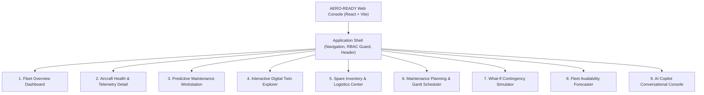

### 19.1 Detailed Dashboard Views

1. **Fleet Overview Dashboard:**
   * Global Mission Capable (MC) gauge, alert banners, and active aircraft status cards.
   * Interactive squadron readiness heatmap color-coded by composite Health Index.
   * Quick-launch contingency action triggers.
2. **Aircraft Health & Telemetry Detail View:**
   * Deep drill-down for individual tail numbers (e.g., Tail #A07).
   * Synchronized time-series charts displaying EGT, core vibration, and hydraulic pressures with regime overlays.
   * Active anomaly indicators and threshold boundary markers.
3. **Predictive Maintenance Workstation:**
   * List of AI-generated diagnostic flags ranked by MAMPI score.
   * Integrated Explainable AI card displaying SHAP feature contributions and counterfactual insights.
   * One-click work order creation and technical order reference lookup.
4. **Interactive Digital Twin Explorer:**
   * Visual component tree hierarchy (Aircraft $\to$ Subsystems $\to$ LRUs).
   * Dynamic wear state rendering, cycle accumulation gauges, and thermal fatigue trackers.
5. **Spare Inventory & Logistics Center:**
   * Real-time stock status across base armories and central supply depots.
   * Condition-driven stockout risk heatmaps and automated replenishment alerts.
6. **Maintenance Planning & Gantt Scheduler:**
   * Drag-and-drop MILP schedule visualizer mapping aircraft to hangar bays and technician teams.
   * Conflict detection flagging overlaps between scheduled maintenance and high-priority sorties.
7. **What-If Contingency Simulator:**
   * Interactive scenario builder allowing users to inject disruptions (groundings, supply halts, mission surges).
   * Side-by-side comparative views of baseline vs. perturbed fleet availability curves.
8. **Fleet Availability Forecaster:**
   * Forward 7, 14, and 30-day stacked area charts projecting FMC, PMC, and NMC tail counts.
   * Monte Carlo uncertainty bounds indicating worst-case, expected, and best-case readiness.
9. **AI Copilot Conversational Console:**
   * Chat interface with streaming markdown responses, interactive telemetry graphs, and verified Technical Order citations.

---

## 20. Security, Governance & Compliance Architecture

Because AERO-READY is designed for defence and national security stakeholders, security is embedded into the core architecture according to defence-in-depth principles.

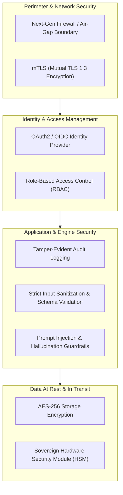

### 20.1 Role-Based Access Control (RBAC) Matrix

| User Role | View Fleet Health | Inspect Telemetry | Approve Work Orders | Run What-If Simulation | Query AI Copilot | Modify System Config |
| :--- | :---: | :---: | :---: | :---: | :---: | :---: |
| **Squadron Commander** | Yes | Yes | Yes (Override) | Yes | Yes | No |
| **Maintenance Officer** | Yes | Yes | Yes | Yes | Yes | No |
| **Depot Technician** | Yes (Assigned) | Yes | Action Only | No | Yes (Technical) | No |
| **Logistics Officer** | Yes (Spares) | No | Spares Only | Yes (Supply) | Yes (Inventory) | No |
| **System Admin** | Audit Only | No | No | No | No | Yes |

### 20.2 Governance & Ethical Safeguards
1. **Tamper-Evident Audit Trail:** Every predictive alert, technician acknowledgment, work order approval, and simulation run is written to an append-only audit log signed with SHA-256 hashes.
2. **Local Air-Gapped Deployment:** The entire system—including machine learning inference, the vector database, and the quantized LLM—operates locally without external cloud connectivity.
3. **Model Watermarking & Integrity:** Machine learning model weights are hashed and verified upon startup to prevent unauthorized tampering or adversarial weight manipulation.

> **Operational Boundary Clarification:** The AERO-READY prototype uses exclusively simulated and non-classified data. It is an engineering demonstrator and is not certified for direct operational connection to active combat data networks.

---

## 21. Technology Stack

| Architectural Layer | Technology Selected | Version / Library | Architectural Justification |
| :--- | :--- | :--- | :--- |
| **Frontend Framework** | React | 19.x | Component reusability, virtual DOM performance, vast ecosystem. |
| **Frontend Language** | TypeScript | 5.x | Type safety across complex aerospace telemetry and DTO contracts. |
| **Styling & Design System** | Tailwind CSS | 3.4.x | Rapid, clean utility-first responsive styling without CSS overhead. |
| **Visual Charts & Metrics** | Recharts / Chart.js | 2.12.x | High-performance SVG/Canvas rendering of multi-stream time-series. |
| **Backend Runtime** | Python | 3.11+ | Native support for aerospace scientific computing, ML, and optimization. |
| **Web API Framework** | FastAPI | 0.110+ | Asynchronous async/await performance, automatic OpenAPI documentation. |
| **Relational & Time-Series DB**| TimescaleDB (PostgreSQL)| 16.x / 2.14 | Seamless handling of relational logistics and partitioned sensor hyper-tables. |
| **In-Memory Cache & Streams** | Redis | 7.2+ | Low-latency caching of twin state vectors and simulated telemetry streams. |
| **Machine Learning Stack** | Scikit-Learn / LightGBM | 1.4+ / 4.3+ | Proven gradient boosting performance on tabular predictive maintenance data. |
| **Deep Learning Engine** | PyTorch | 2.2+ | Flexible implementation of Autoencoders, LSTMs, and custom loss functions. |
| **Explainable AI (XAI)** | SHAP | 0.45+ | Shapley value game-theoretic feature importance attribution. |
| **Graph Modeling** | NetworkX | 3.2+ | In-memory directed graph propagation for the Maintenance Impact Graph. |
| **Mathematical Optimization** | PuLP / Google OR-Tools | 2.8+ / 9.9+ | Industrial-grade Mixed-Integer Linear Programming (MILP) solver. |
| **Copilot Orchestration** | LangChain | 0.1.x | Robust chains for multi-modal context retrieval and prompt construction. |
| **Vector Database** | FAISS / pgvector | 1.8+ / 0.6+ | Local vector similarity indexing for technical order search. |
| **Local LLM Engine** | Ollama / llama.cpp | Llama-3-8B (Q4) | Fast, private on-premise inference requiring zero cloud dependencies. |
| **Testing Framework** | PyTest & Vitest | Latest | Automated unit, regression, integration, and property-based testing. |
| **Containerization** | Docker & Compose | 26.x | Deterministic multi-container environment orchestration for reproducible demos. |

---

## 22. Repository Structure

```
aero-ready/
├── docs/                                  # Complete System & SIH Documentation
│   ├── AERO_READY_DOCUMENTATION.md        # Comprehensive Master Engineering Document
│   ├── SIH_PRESENTATION_NOTES.md          # Defense & Jury Q&A Talking Points
│   └── architecture_diagrams/             # Exported System & Pipeline Visuals
├── data/                                  # Data Engineering & Datasets
│   ├── raw/                               # Public Benchmarks (NASA C-MAPSS subset)
│   ├── synthetic/                         # Synthetic Flight Telemetry & Tech Logs
│   ├── processed/                         # Cleaned & Regime-Normalized Feature Stores
│   └── technical_orders/                  # Synthetic PDF/Markdown Maintenance Manuals
├── ml/                                    # Machine Learning & AI Modules
│   ├── anomaly_detection/                 # Isolation Forest & Autoencoder Pipelines
│   ├── failure_prediction/                # LightGBM Failure Classifiers
│   ├── rul_estimation/                    # Bi-LSTM Remaining Useful Life Models
│   ├── explainability/                    # SHAP Attributions & Counterfactuals
│   └── evaluation/                        # Validation Scripts & Scoring Metrics
├── digital_twin/                          # Digital Twin State Machine
│   ├── entity_models.py                   # Hierarchical Airframe, Subsystem & LRU Classes
│   ├── state_manager.py                   # Real-Time State Vector Accumulator & Sync
│   └── fatigue_calculator.py              # Rainflow Stress-Cycle Counting
├── optimization/                          # Prescriptive & Operations Research Engines
│   ├── impact_graph.py                    # NetworkX Maintenance Impact Graph
│   ├── milp_scheduler.py                  # PuLP Maintenance Schedule Optimizer
│   └── spare_optimizer.py                 # Dynamic Poisson Inventory Reorder Model
├── ai_copilot/                            # RAG Maintenance Assistant
│   ├── vector_indexer.py                  # Technical Order Embeddings & Chunking
│   ├── retriever.py                       # Hybrid Keyword + Dense Semantic Search
│   └── copilot_service.py                 # Prompt Guardrails & Local LLM Connector
├── backend/                               # FastAPI Core Application
│   ├── app/
│   │   ├── api/                           # REST Endpoint Routers (v1)
│   │   ├── core/                          # Security, JWT, Database Connections
│   │   ├── models/                        # SQLAlchemy & Pydantic Schemas
│   │   └── services/                      # Business Logic Wrappers
│   ├── main.py                            # Application Entry Point
│   └── Dockerfile                         # Production Backend Container Spec
├── frontend/                              # React 19 Frontend Web Console
│   ├── src/
│   │   ├── components/                    # Reusable UI Atoms, Gauges & Navigation
│   │   ├── views/                         # 9 Dedicated Operational Dashboard Pages
│   │   ├── hooks/                         # Telemetry & API Integration Hooks
│   │   └── types/                         # TypeScript Interface Definitions
│   ├── package.json                       # Frontend Dependencies
│   └── vite.config.ts                     # Build Configuration
├── scripts/                               # DevOps, Seeding & Demonstration Utilities
│   ├── generate_synthetic_data.py         # Generates 12-Aircraft Synthetic Telemetry
│   ├── seed_database.py                   # Populates Postgres with Initial State
│   └── run_demo_scenario.py               # Executes Aircraft A07 End-to-End Simulation
├── tests/                                 # Automated Test Suite
│   ├── unit/                              # ML, Math & Graph Unit Tests
│   ├── integration/                       # Backend API & Database End-to-End Tests
│   └── test_optimization.py               # MILP Constraint Feasibility Tests
├── docker-compose.yml                     # Multi-Service Orchestrator (FastAPI, Postgres, Redis)
└── README.md                              # Project Overview & Quickstart Guide
```

---

## 23. Implementation Roadmap

The development of AERO-READY is organized into ten systematic, deliverables-driven phases:

```mermaid
gantt
    title AERO-READY 10-Phase Development Roadmap
    dateFormat  X
    axisFormat  Day %d

    section Foundation
    Phase 1: Ingestion & Pipelines       :active, p1, 0, 3
    Phase 2: Anomaly Detection           :p2, 3, 6
    Phase 3: Failure & RUL Prognostics   :p3, 6, 10

    section Core Engines
    Phase 4: Digital Twin State Sync     :p4, 10, 13
    Phase 5: Prescriptive Impact Graph   :p5, 13, 17
    Phase 6: Spare Inventory Optimizer   :p6, 17, 20

    section System Intelligence
    Phase 7: Fleet Availability Engine   :p7, 20, 23
    Phase 8: What-If Contingency Sim     :p8, 23, 26
    Phase 9: RAG AI Copilot              :p9, 26, 29

    section Integration
    Phase 10: Unified Command Dashboard  :p10, 29, 33
```

| Phase | Phase Name | Primary Technical Tasks | Expected Output Deliverable | Verification & Validation Gate |
| :--- | :--- | :--- | :--- | :--- |
| **Phase 1** | Data Pipeline & Schema | Establish PostgreSQL / TimescaleDB schema; write synthetic telemetry generator. | Validated ingestion of 12-aircraft sensor streams. | Synthetic data generator passes all physical constraint checks ($\Delta T, P > 0$). |
| **Phase 2** | Anomaly Detection | Implement Isolation Forest and Deep Autoencoder on regime-normalized data. | Anomaly scoring service with dynamic thresholding. | False Alarm Rate (FAR) $< 5\%$ on nominal synthetic flight traces. |
| **Phase 3** | Failure & RUL Prognostics | Train LightGBM classifier and Bi-LSTM on C-MAPSS and synthetic wear sets. | 50h failure probability and RUL $\pm 90\%$ CI endpoints. | MAE $\le 12.5$ flight hours on benchmark validation set. |
| **Phase 4** | Digital Twin Modeling | Implement hierarchical state-machine classes and cumulative cycle accumulator. | In-memory twin tracking wear states across all 12 airframes. | State synchronization verified across 100 simulated flights. |
| **Phase 5** | Prescriptive Intelligence | Construct NetworkX Maintenance Impact Graph and automated work-order generator. | Prescriptive action cards with mapped Technical Orders. | Graph traversal successfully maps component fault to fleet-readiness impact. |
| **Phase 6** | Spare Optimization | Formulate dynamic Poisson demand and safety-stock calculation engine. | Automated reorder and stockout warning dashboard. | Successfully detects impending stockout 72 hours prior to scheduled repair. |
| **Phase 7** | Fleet Availability | Build forward Monte Carlo availability forecaster (7, 14, 30 days). | Stacked FMC/PMC/NMC readiness projection curves. | Readiness projections correctly update when tail status is toggled. |
| **Phase 8** | What-If Simulator | Develop discrete contingency simulator and MILP re-optimization engine. | Interactive simulation API handling 5 disruption scenarios. | Generates alternative feasible schedule in $< 1.5$ seconds. |
| **Phase 9** | RAG AI Copilot | Index synthetic Technical Orders into FAISS; configure local LangChain LLM pipeline. | Advisory chat interface with sensor awareness and citations. | Zero ungrounded hallucinations across 50 test maintenance queries. |
| **Phase 10** | Integrated Dashboard | Build 9 React dashboard views; connect REST APIs; conduct end-to-end demo testing. | Fully responsive, production-grade web application. | Complete end-to-end execution of Aircraft A07 scenario without errors. |

---

## 24. Evaluation Framework & Metrics

To maintain engineering objectivity, AERO-READY strictly distinguishes between **Target Benchmarks** (theoretical targets) and **System Validation Gates**:

### 24.1 Machine Learning & Prognostics Metrics

| Metric | Mathematical Definition | Target Threshold | Validation Dataset |
| :--- | :--- | :--- | :--- |
| **Anomaly Precision** | $TP / (TP + FP)$ | $\ge 92.0\%$ | Synthetic Injected Telemetry |
| **Anomaly Recall** | $TP / (TP + FN)$ | $\ge 95.0\%$ | Synthetic Injected Telemetry |
| **False Alarm Rate** | $FP / \text{Total Nominal Hours}$ | $< 2 \text{ per } 1,000 \text{h}$ | Unperturbed Flight Data |
| **Failure ROC-AUC** | Area under ROC Curve | $\ge 0.94$ | Multi-class Fault Set |
| **RUL MAE** | $\frac{1}{N}\sum \|y_i - \hat{y}_i\|$ | $\le 12.0 \text{ EFH}$ | NASA C-MAPSS FD001 |
| **RUL Early-Bias Score**| Asymmetric PHM Scoring Metric | $S < 450$ | NASA C-MAPSS Benchmark |

### 24.2 Operational & Fleet Maintenance Metrics

| Operational Metric | Traditional Reactive/Calendar Baseline | AERO-READY Target Performance | Evaluation Method |
| :--- | :--- | :--- | :--- |
| **Unplanned Groundings (AOG)** | $18\% - 24\%$ of all maintenance events | $< 6\%$ of all maintenance events | 90-day simulated fleet run |
| **Average Repair Lead Time** | 48 hours (waiting for spares/bays) | 16 hours (pre-positioned resources) | Simulated depot workflow |
| **Spare Stockout Frequency** | $12\%$ of unscheduled repair actions | $< 2.5\%$ through predictive reorder | 30-day inventory simulation |
| **Fleet Mission-Capable Rate** | $68\% - 74\%$ average availability | $\ge 82\% - 85\%$ sustained readiness | Simulated squadron operations |
| **Optimization Solver Latency** | Manual planning: 4 to 8 hours | Algorithmic MILP: $< 2.0$ seconds | Computational benchmark |

---

## 25. End-to-End Demonstration Scenario

To demonstrate the practical utility of AERO-READY during evaluation and judging, the following concrete synthetic scenario is executed:

```mermaid
sequenceDiagram
    autonumber
    actor A07 as Aircraft Tail #A07 (In Flight)
    participant Edge as Onboard Telemetry Agent
    participant AI as AI Health Engine
    participant Twin as Digital Twin
    participant Graph as Impact Graph
    participant MILP as Fleet Optimizer
    participant UI as Commander Dashboard

    A07->>Edge: Spool vibration reaches 3.8 mm/s; delta EGT rises +34°C
    Edge->>AI: Stream Telemetry Batch to Ingestion API
    AI->>AI: Autoencoder flags anomaly (Score: 0.88); LightGBM 50h Fail Risk = 79%
    AI->>AI: Bi-LSTM computes RUL: 16.4 Flight Hours (CI: 14.1 - 18.7)
    AI->>Twin: Update Subsystem State: Propulsion Health Index drops to 41/100
    Twin->>Graph: Propagate Degradation to Subsystem & Aircraft Node
    Graph->>Graph: Trigger Maintenance Requirement: Replace Turbine Bearing
    Graph->>MILP: Query Available Spares & Hangar Slots
    MILP->>MILP: Detects Sortie Conflict (A07 scheduled for QRA Patrol tomorrow)
    MILP->>MILP: Computes Reassignment: Swap Sortie to A03; Schedule A07 into Bay 1 tonight
    MILP-->>UI: Alert Commander: Prescriptive Action Card + Recommended Swap
    UI->>UI: Commander clicks "Approve Plan": Work Order #WO-801 issued; Spares Reserved
```

### Step-by-Step Scenario Execution Walkthrough

1. **Sensor Anomaly Detection:**
   During a routine medium-altitude patrol flight, Aircraft A07's high-pressure spool vibration increases from nominal ($1.4 \text{ mm/s}$) to $3.8 \text{ mm/s}$, and turbine exhaust gas temperature residual rises by $+34^\circ\text{C}$.
2. **AI Prognostic Trigger:**
   The Anomaly Autoencoder flags an anomaly score of $0.88$. LightGBM calculates a $79\%$ probability of turbine bearing failure within 50 flight hours. The Bi-LSTM models predict a remaining useful life of only $16.4$ equivalent flight hours.
3. **Digital Twin State Update:**
   The Propulsion Subsystem Health Index drops from $94$ to $41$. Aircraft A07's status transitions to **Partially Mission Capable (PMC)**.
4. **Graph Impact Propagation:**
   The Maintenance Impact Graph traverses dependencies:
   $$\text{Bearing Failure} \longrightarrow \text{Engine Seizure Risk} \longrightarrow \text{Grounding} \longrightarrow \text{Squadron Alert Shortfall}$$
5. **Logistics & Spare Verification:**
   The inventory engine verifies that replacement Bearing Unit (`SP-TRB-101`) has 1 unit in local base stock and 4 at Central Depot. The local unit is placed on hold.
6. **Mission-Aware Conflict Resolution:**
   Aircraft A07 was slated for a critical air-defence patrol in 14 hours. The optimization engine recognizes that flying A07 consumes its final safety margin.
7. **Prescriptive Action Plan:**
   The system generates an automated prescription:
   * **Action:** Swap A07's tomorrow mission to Aircraft A03 (healthy, $HI = 96$).
   * **Work Order:** Induct A07 into Hangar Bay 1 at 20:00 hours tonight for a 6-hour bearing replacement and vibration re-balance.
8. **Commander Decision Support:**
   The Operations Commander inspects the explainability card, reviews the SHAP feature breakdown and technical order citation, and clicks **"Authorize Maintenance & Sortie Swap"**. Fleet readiness is preserved without mission cancellation.

---

## 26. Innovation Summary

| Innovation Dimension | Existing Industry / Defence Challenge | AERO-READY Technical Contribution |
| :--- | :--- | :--- |
| **Multi-Source Data Fusion** | Telemetry, technical records, and ERP inventory operate in isolated data silos. | Unified canonical schema fusing high-rate time-series with discrete maintenance logs and supply availability. |
| **Mission-Aware Maintenance** | Maintenance schedules ignore upcoming tactical sortie criticality, leading to operational mission groundings. | Multi-criteria optimization balancing component risk against mission importance and operational windows. |
| **Maintenance Impact Graph** | Inability to foresee how a minor localized mechanical fault affects base-wide readiness. | Graph-based propagation model linking components $\to$ subsystems $\to$ aircraft $\to$ facilities $\to$ fleet availability. |
| **Prescriptive Action Generation**| Tools predict failure dates but fail to recommend concrete, resource-backed repair actions. | Automated work-order generation specifying required parts, estimated labor hours, and hangar allocation. |
| **Condition-Driven Spare Planning**| Supply chains rely on historical MTBF averages, causing stockouts during operational surges. | Dynamic Poisson demand forecasting driven directly by real-time RUL degradation trajectories. |
| **Interactive What-If Simulation** | Contingency planning is slow, manual, and disconnected from live mechanical aircraft states. | Real-time discrete-event simulation engine evaluating disruptions and generating remediations in $< 2$ seconds. |
| **Explainable AI (XAI)** | Black-box deep learning models are rejected by certified aerospace maintenance technicians. | Game-theoretic SHAP feature attributions and counterfactual reasoning providing verifiable failure drivers. |
| **Grounded AI Copilot** | Generic LLMs hallucinate part numbers and lack access to private operational telemetry. | Local, private RAG architecture combining live sensor parameters with official Technical Orders. |

---

## 27. Operational Advantages

* **Transition from Reactive to Condition-Based Sustainment:** Eliminates costly "run-to-failure" emergency repairs while avoiding the premature replacement of healthy components.
* **Minimized Unplanned Groundings (AOG):** Incipient anomalies are detected 30 to 50 flight hours before operational disruption occurs.
* **Optimized Fleet Readiness Rates:** Fleet availability is mathematically optimized across the squadron, sustaining mission-capable rates at or above operational targets.
* **Synchronized Maintenance & Logistics:** Eliminates aircraft dwell time caused by waiting for out-of-stock spare parts.
* **Reduced Cognitive Load on Maintenance Personnel:** Technicians receive root-cause explanations and technical order citations, accelerating troubleshooting.
* **Resilient Operational Contingency Planning:** Commanders can stress-test base operations against supply shocks and mission surges before committing assets.

---

## 28. System Limitations & Boundary Conditions

To maintain academic and professional credibility, the following limitations are explicitly acknowledged:

1. **Non-Classified & Synthetic Prototype Data:** The current implementation is validated using public NASA benchmarks and synthetic flight telemetry. It has not been trained on proprietary or classified operational defence flight records.
2. **Model Generalization Across Airframe Classes:** A model trained on a specific turbofan engine profile (e.g., C-MAPSS) cannot be applied to dissimilar propulsion systems (e.g., turboprops or high-bypass commercial engines) without retraining and domain adaptation.
3. **Sensor Quality & Degradation:** The system assumes sensor calibration integrity. While filtering algorithms catch transient dropouts, complex drift mimicking real component degradation remains challenging without dual-redundant sensor arrays.
4. **Prognostic Uncertainty Bounds:** Remaining Useful Life (RUL) predictions are statistical estimates; confidence bounds widen significantly when predicting failures further than 60 flight hours into the future.
5. **Decision-Support Boundary:** AERO-READY is strictly an advisory decision-support platform. It cannot and must not issue autonomous commands that alter aircraft flight control software or bypass certified human maintenance sign-offs.
6. **Regulatory Certification:** Full operational deployment in military or civil aviation requires rigorous formal certification (e.g., DO-178C for software, DO-254 for hardware, CEMILAC approval in the Indian defence context).

---

## 29. Future Research & Operational Scope

1. **Authorized Defence Telemetry Ingestion:** Transition from synthetic datasets to authorized, de-identified telemetry from operational military transport or trainer fleets under official supervision.
2. **Edge Computing Integration:** Deploy quantized anomaly detection models directly onto onboard mission computers (smart line-replaceable units) for real-time in-flight diagnostics.
3. **Federated Learning Across Airbases:** Train predictive maintenance models collaboratively across geographically dispersed airbases without centralizing sensitive telemetry data.
4. **Multi-Base Collaborative Optimization:** Extend the MILP scheduling engine to coordinate cross-base logistics transfers, depot heavy maintenance rotations, and joint theater fleet readiness.
5. **Augmented Reality (AR) Maintenance Overlay:** Connect the AERO-READY Prescriptive Engine and AI Copilot to technician AR headsets to overlay diagnostic telemetry directly onto physical aircraft components.

---

## 30. Ethical, Safety & Human-in-the-Loop Considerations

* **Human Authority in Command:** AERO-READY enforces a strict **Human-in-the-Loop (HITL)** architecture. Every maintenance action, work order generation, and flight rescheduling proposal remains a recommendation until approved by an authorized maintenance officer.
* **No Autonomous Flight or Weapon Control:** The software platform has zero physical or digital interfaces with aircraft fly-by-wire flight-control surfaces or tactical weapon systems.
* **Transparent System Accountability:** Every AI-generated output is accompanied by confidence intervals, SHAP feature rankings, and source citations, enabling human operators to verify the rationale before committing resources.
* **Data Sovereignty:** Engineered to run in completely air-gapped, on-premise environments, ensuring that national defence operational tempo data cannot leak to external networks.

---

## 31. Conclusion

The operational readiness of an air fleet is determined not only by the performance of its aircraft in the air, but by the efficiency of the sustainment ecosystem on the ground. Problem Statement **SIH26249** identifies a decisive operational challenge: *fragmented, reactive maintenance practices cause avoidable aircraft downtime, supply bottlenecks, and sub-optimal asset utilization.*

**AERO-READY** addresses this challenge through an integrated intelligence architecture:

$$\mathbf{Predict} \longrightarrow \mathbf{Explain} \longrightarrow \mathbf{Simulate} \longrightarrow \mathbf{Optimize} \longrightarrow \mathbf{Forecast}$$

By fusing high-frequency sensor telemetry, historical maintenance records, and inventory availability into a mission-aware decision-support framework, AERO-READY transforms raw, disconnected data into actionable operational readiness. The platform empowers maintenance technicians to catch micro-anomalies early, enables supply officers to preempt parts shortages, and equips air fleet commanders with the forward visibility needed to sustain air power readiness.

---
*AERO-READY: Mission-Aware Predictive Maintenance & Fleet Availability Intelligence — Smart India Hackathon 2026.*
