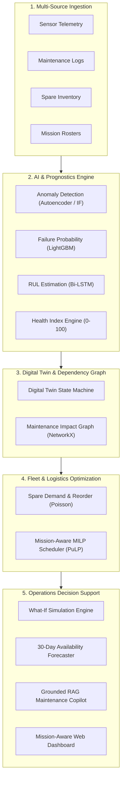

# AERO-READY

### Mission-Aware Predictive Maintenance & Fleet Availability Intelligence

[](https://sih.gov.in)
[](#)
[](#)
[](#)
[](#)

---

## 📌 Executive Overview

**AERO-READY** is an AI-powered, mission-aware aircraft sustainment and fleet availability intelligence platform developed for **Smart India Hackathon 2026** (Problem Statement ID: **SIH26249**, Ministry of Defence / Defence Services Staff College).

Rather than functioning solely as an isolated failure prediction model, AERO-READY executes an integrated five-stage decision-support cycle:

$$\mathbf{Predict} \longrightarrow \mathbf{Explain} \longrightarrow \mathbf{Simulate} \longrightarrow \mathbf{Optimize} \longrightarrow \mathbf{Forecast}$$

The platform shifts air power maintenance decision-making from:
> *"Which aircraft may fail?"*

to:
> *"What maintenance action should be performed, when should it be performed, what resources and spares are required, how will the decision affect squadron fleet availability, and what alternative plan should be executed if operational constraints change?"*

---

## 📖 Complete Documentation

The complete, exhaustive 31-section master engineering documentation is available at:
👉 **[PROJECT_DOCUMENTATION.md](file:///c:/Users/Saisanapathi/Downloads/aero-ready/PROJECT_DOCUMENTATION.md)**

It covers:
* Mathematical formulations for Composite Health Index ($HI$), RUL estimation, and the Mission-Aware Maintenance Priority Index ($\text{MAMPI}$).
* Detailed 9-layer system architecture with Mermaid flowcharts and component diagrams.
* Hybrid AI and Physics-Informed algorithms (Brayton cycle residual modeling, Rainflow stress-cycle counting).
* Maintenance Impact Graph dependency propagation ($\text{Component} \to \text{Subsystem} \to \text{Aircraft} \to \text{Facilities} \to \text{Fleet Readiness}$).
* Dynamic Poisson inventory optimization and spare-parts stockout forecasting.
* 5 detailed What-If contingency simulation scenarios with recovery plans.
* RAG-based AI Maintenance Copilot architecture with anti-hallucination protocols.
* Complete PostgreSQL + TimescaleDB database schemas and DDL.
* 9 dedicated frontend dashboard view specifications.
* Enterprise defence security, RBAC, and governance framework.
* 10-phase engineering roadmap and validation benchmarks.

---

## 🚀 Core Capabilities



### Key Differentiators
1. **Multi-Source Data Fusion:** Merging continuous telemetry with unstructured maintenance records and ERP parts stock.
2. **Mission-Aware Maintenance Reasoning:** Prioritizing maintenance based on upcoming sortie criticality, not mechanical risk alone.
3. **Graph-Based Maintenance Impact Propagation:** Modeling how a single component degradation cascades into squadron availability constraints.
4. **Prescriptive Maintenance:** Automated generation of work orders, required spares, bay allocations, and labor estimates.
5. **Interactive What-If Simulation:** Real-time re-optimization under sudden base closures, supply chain halts, or sortie surges.
6. **Explainable AI & Grounded Copilot:** SHAP feature attributions and a local RAG assistant citing verified Technical Orders.

---

## 🛠️ Technology Stack

| Layer | Technologies |
| :--- | :--- |
| **Frontend** | React 19, TypeScript, Tailwind CSS, Recharts, Lucide Icons |
| **Backend API** | Python 3.11, FastAPI, Pydantic, Uvicorn |
| **Databases** | TimescaleDB (PostgreSQL 16), Redis 7.2 |
| **AI / ML & Prognostics** | Scikit-Learn, LightGBM, PyTorch (Autoencoder, Bi-LSTM) |
| **Explainable AI (XAI)** | SHAP (SHapley Additive exPlanations) |
| **Operations Research & Graphs**| NetworkX (Impact Graph), PuLP / OR-Tools (MILP Scheduling) |
| **AI Copilot & RAG** | LangChain, FAISS / pgvector, Sentence-Transformers, Local Quantized LLM |
| **Testing & Deployment** | PyTest, Vitest, Docker, Docker Compose |

---

## 📁 Repository Directory Structure

```
aero-ready/
├── docs/                                  # Detailed Architectural & Presentation Docs
│   └── AERO_READY_DOCUMENTATION.md        # Reference Mirror of Master Documentation
├── data/                                  # Data Engineering Assets
│   ├── raw/                               # Public Benchmarks (NASA C-MAPSS)
│   ├── synthetic/                         # Synthetic Telemetry, Logs & Spares
│   ├── processed/                         # Regime-Normalized Feature Store
│   └── technical_orders/                  # Synthetic Technical Manuals
├── ml/                                    # AI / Machine Learning Pipelines
│   ├── anomaly_detection/                 # Isolation Forest & Autoencoder
│   ├── failure_prediction/                # LightGBM Failure Classifiers
│   ├── rul_estimation/                    # Bi-LSTM Remaining Useful Life Models
│   ├── explainability/                    # SHAP Attributions & Counterfactuals
│   └── evaluation/                        # Validation Metrics Scripts
├── digital_twin/                          # Digital Twin State Machine
│   ├── entity_models.py                   # Airframe, Subsystem & LRU Models
│   ├── state_manager.py                   # State Vector Sync & In-Memory Store
│   └── fatigue_calculator.py              # Rainflow Stress-Cycle Counting
├── optimization/                          # Prescriptive & Optimization Engines
│   ├── impact_graph.py                    # NetworkX Maintenance Impact Graph
│   ├── milp_scheduler.py                  # PuLP Maintenance Schedule Optimizer
│   └── spare_optimizer.py                 # Dynamic Poisson Inventory Model
├── ai_copilot/                            # RAG Maintenance Assistant
│   ├── vector_indexer.py                  # Technical Order Embeddings & Chunking
│   ├── retriever.py                       # Hybrid Semantic & Keyword Retriever
│   └── copilot_service.py                 # Grounded RAG Response Pipeline
├── backend/                               # FastAPI Backend Application
│   ├── app/
│   │   ├── api/                           # REST Endpoint Routers (v1)
│   │   ├── core/                          # Security, JWT, Database Config
│   │   ├── models/                        # SQLAlchemy & Pydantic Schemas
│   │   └── services/                      # Engine Service Connectors
│   ├── main.py                            # FastAPI App Entry Point
│   └── Dockerfile                         # Container Configuration
├── frontend/                              # React 19 Frontend Web Console
│   ├── src/
│   │   ├── components/                    # UI Components & Gauges
│   │   ├── views/                         # 9 Operational Dashboard Pages
│   │   └── types/                         # TypeScript Interfaces
│   ├── package.json                       # Dependencies
│   └── vite.config.ts                     # Build Configuration
├── scripts/                               # Data Seeding & Simulation Scripts
│   ├── generate_synthetic_data.py         # 12-Aircraft Physics-Based Data Generator
│   ├── seed_database.py                   # Initial Database Populator
│   └── run_demo_scenario.py               # End-to-End A07 Scenario Runner
├── tests/                                 # Automated Test Suite
│   ├── unit/                              # ML & Optimization Unit Tests
│   └── integration/                       # Backend API & Database Tests
├── docker-compose.yml                     # Multi-Container Compose File
├── PROJECT_DOCUMENTATION.md               # Complete 31-Section Master Documentation
└── README.md                              # This Document
```

---

## 🚦 End-to-End Demonstration Scenario (Aircraft A07)

During demonstration and jury review, AERO-READY executes a realistic, synthetic end-to-end mission-maintenance scenario:

```
[1. Sensor Anomaly]       --> Aircraft A07 core vibration rises to 3.8 mm/s; delta EGT rises +34°C.
[2. AI Prognosis]         --> Autoencoder flags 0.88 anomaly; LightGBM computes 79% 50h failure risk;
                              Bi-LSTM predicts RUL of 16.4 Flight Hours.
[3. Digital Twin Sync]    --> Propulsion Subsystem Health Index drops to 41/100; status changes to PMC.
[4. Impact Propagation]   --> Impact Graph identifies critical alert: A07 scheduled for QRA Patrol in 14h.
[5. Spare Verification]   --> Logistics checks local stock: 1 Turbine Bearing (SP-TRB-101) on-hand; reserves it.
[6. MILP Optimization]    --> Generates optimal contingency: Swaps QRA Patrol to healthy Aircraft A03;
                              schedules A07 into Bay 1 tonight for 6h overhaul.
[7. Commander Decision]   --> Commander inspects SHAP explanation card, reviews citations, and approves.
                              Fleet readiness quota (75% min) is preserved with zero mission cancellations.
```

---

## 🔒 Security & Operational Notice

* **Prototype Status:** AERO-READY is an engineering prototype and technology demonstrator built for Smart India Hackathon 2026.
* **Data Sources:** All experimental datasets, sensor telemetry streams, flight logs, and spares inventories are synthetic or derived from non-classified public aerospace benchmarks (e.g., NASA Prognostics Center of Excellence).
* **Decision Support Only:** The system does not directly interface with aircraft flight-control or weapon systems. All maintenance recommendations require human-in-the-loop authorization by certified personnel.

---

## 📜 Citation & Credits
* **Problem Statement:** SIH26249 — Air Power: Predictive Maintenance & Fleet Availability
* **Organization:** Ministry of Defence (MoD) / Defence Services Staff College (DSSC)
* **Team:** AERO-READY Engineering Team (SIH 2026)
